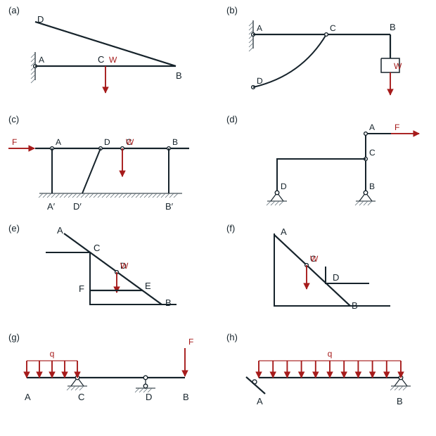
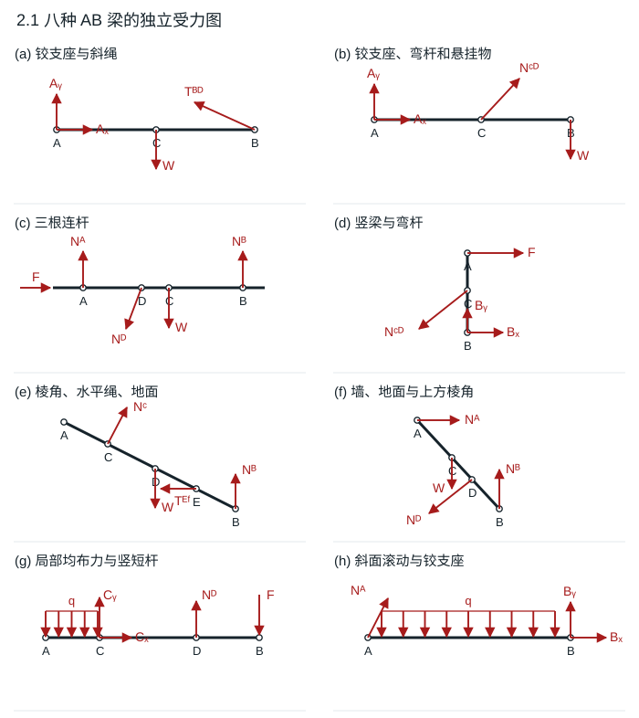
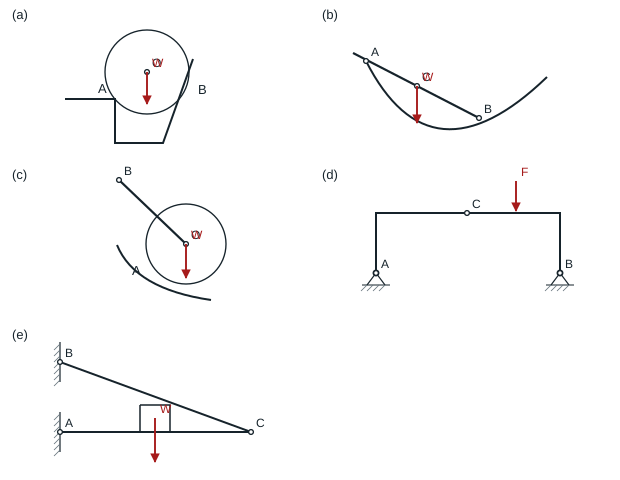
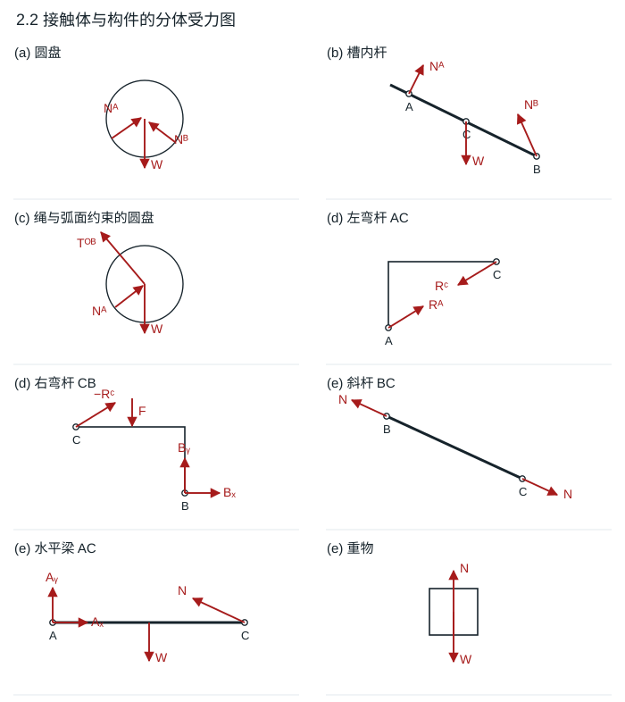
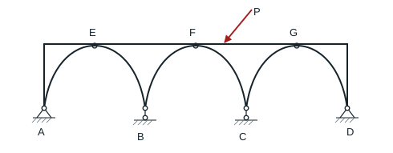
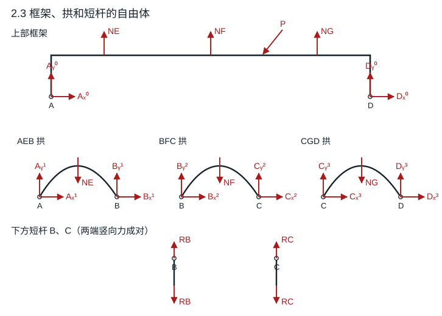

# 第 2 章 静力学基本概念与受力分析

教材第 18–19 页。取右、上为正，铰反力用两个分量表示。未注明重量的构件按无重处理。表中给出的箭头与作用点可直接用于重画受力图。

## 2.1 八种支承下的 AB 梁

### 题目

**题意**　把八种支承形式下的 $AB$ 梁从周围构件中单独取出。

**已知条件**　(a) $A$ 铰、$B$ 由斜绳 $BD$ 牵住，$W$ 作用于 $C$；(b) $A$ 铰、$C$ 接两端铰接的弯杆 $CD$、$B$ 悬挂 $W$；(c) 水平梁在 $A,B$ 接竖杆、在 $D$ 接斜杆，左端受向右的 $F$，$C$ 受向下的 $W$；(d) 竖梁顶端受向右的 $F$，底端 $B$ 铰支，中间 $C$ 接两端铰接的弯杆 $CD$，$D$ 在左下方；(e) 斜梁 $B$ 着地，$C$ 搁在左侧棱角上，$D$ 受 $W$，$E$ 被水平绳牵向左边的 $F$ 点；(f) 斜梁两端分别靠左墙和地面，右侧棱角在 $D$ 接触，$C$ 受 $W$；(g) $C$ 铰支、$D$ 接竖向短杆，$AC$ 段受向下均布载荷 $q$，$B$ 受向下的 $F$；(h) $A$ 是斜面滚动支座、$B$ 是固定铰，全跨向下均布载荷 $q$。未标重力的构件按无重处理。

**求解要求**　分别画出八根梁的自由体图。

### 解答

每个子图只隔离 $AB$，把移除的连接换成以下力。

| 子图 | $AB$ 上的力 |
|---|---|
| a | $A$ 的 $A_x,A_y$；$B$ 沿 $BD$ 指向 $D$ 的绳拉力；$C$ 的 $W$ 向下。 |
| b | $A$ 的两分量；$C$ 沿两铰点连线 $CD$ 的力；$B$ 的悬挂物拉力 $W$ 向下。弯杆 $CD$ 无其他荷载，仍是二力构件。 |
| c | 左端 $F$ 向右，$C$ 的 $W$ 向下；$A$、$B$ 分别沿两竖杆；$D$ 沿斜杆 $DD'$。由水平平衡，斜杆对梁的水平分力向左。 |
| d | $A$ 的 $F$ 向右；$B$ 的两分量；$C$ 的力沿弯杆 $CD$ 的两端连线。 |
| e | $C$ 的光滑棱角反力垂直于 $AB$ 指向右上；$D$ 的 $W$ 向下；$E$ 的水平绳力朝 $F$；$B$ 的地面法向力向上。 |
| f | $A$ 的墙面法向力向右；$B$ 的地面法向力向上；$D$ 的棱角反力垂直于梁指向左下；$C$ 的 $W$ 向下。 |
| g | $C$ 的两分量；$D$ 沿竖向短杆；左段分布载荷 $q$ 和 $B$ 的集中力 $F$ 均向下。 |
| h | $A$ 的滚动支座反力垂直斜面；$B$ 的两分量；全跨均布载荷 $q$ 向下。 |

**结果**　铰支座没有反力偶，光滑接触没有切向力，二力杆的作用线由两端连接点确定。

## 2.2 五组物体的分体受力

### 题目

**题意**　对五组装置逐件隔离。(a) 槽中圆盘；(b) 弧槽中的直杆；(c) 由绳约束的圆盘；(d) 两件铰接门形构件；(e) 支承重物的三角架。

**已知条件**　(a) 圆盘在左侧棱角 $A$ 和右侧斜面 $B$ 接触，重心 $O$；(b) 杆在槽口 $A$ 与槽壁 $B$ 接触，$C$ 受重力；(c) 圆盘与弧面在 $A$ 接触，绳从 $O$ 牵向左上方 $B$；(d) 左件 $AC$、右件 $CB$ 在 $C$ 铰接，两足均为铰支，$F$ 作用于右件上缘；(e) 水平梁 $AC$ 左端铰于墙，斜杆 $BC$ 两端铰接，重物放在梁上。只考虑标明的重力，接触按光滑处理。

**求解要求**　画各物体的受力图，销钉和支座不单独画。

### 解答

| 子图 | 研究对象 | 外力 |
|---|---|---|
| a | 圆盘 | 圆心重力 $W$ 向下；$A$、$B$ 接触力分别沿各自接触点到圆心的方向。 |
| b | 直杆 | $C$ 点重力向下；$A$ 为棱角接触，力垂直杆；$B$ 处力沿槽的局部法线，指向槽内。 |
| c | 圆盘 | $W$ 向下；$A$ 处法向力通过 $O$；$O$ 处绳力沿 $OB$ 指向 $B$。 |
| d | 左件 $AC$ | 二力构件，两端力沿 $AC$，等大反向。 |
| d | 右件 $CB$ | $C$ 处受左件的力，方向与左件所受 $C$ 力相反；$B_x,B_y$；图示集中力 $F$。如将 $B$ 反力合成一支箭头，其作用线应通过另外两力作用线的交点。 |
| e | 斜杆 $BC$ | 两端沿 $BC$ 的一对等大反向的轴向力。 |
| e | 水平梁 $AC$ | $A_x,A_y$；$C$ 处来自斜杆的力；重物对梁的竖向压力。 |
| e | 重物 | $W$ 向下，梁给的支持力向上，静止时两者等大。 |

**结果**　连接力的两支反向箭头分别画在两张分体图上。

## 2.3 上部框架、三拱与短连杆

### 题目

**题意**　拆分一个上部门形框架、三个拱和两根短连杆组成的体系。

**已知条件**　拱依次为 $AEB,BFC,CGD$，拱顶在 $E,F,G$ 与框架相接。框架两端与端拱共用地面铰 $A,D$，拱间公共销 $B,C$ 各连一根竖直短杆。斜向力 $P$ 作用于上横梁的 $FG$ 段，指向左下。未注明的重量忽略，拱顶小圆按光滑滚子处理。

**求解要求**　分别画出框架、各拱和两根短杆的受力图。

### 解答

$E,F,G$ 的小圆位于框架下表面与拱顶之间，按图作光滑滚子接触处理，三对接触力均竖直。把三个拱和外框分开，端部公共铰的力按作用对象分别命名。

| 研究对象 | 应画的外力 |
|---|---|
| 上部框架 | 图示 $P$；$A$、$D$ 对框架的两分量；拱经滚子施加的 $N_E,N_F,N_G$ 向上。 |
| 左拱 $AEB$ | $A$、$B$ 的铰力分量；拱顶 $N_E$ 向下。 |
| 中拱 $BFC$ | $B$、$C$ 的铰力分量；拱顶 $N_F$ 向下。 |
| 右拱 $CGD$ | $C$、$D$ 的铰力分量；拱顶 $N_G$ 向下。 |
| $B$、$C$ 下短杆 | 各自两端等大反向的竖向力。 |

**结果**　$B,C$ 处短杆本身不传水平力，但两相邻拱的水平铰力可在公共销处互相平衡。$A,D$ 的地面反力等于该处各构件铰力的矢量和。
