# 第 3 章 平面任意力系的简化和平衡

教材第 40–43 页。取右、上、逆时针为正。反力分量负号表示与假定相反。

## 3.1 刚架顶端水平力

### 题目

**题意**　水平荷载作用在门形刚架的左上角。

**已知条件**　左脚 $A$ 是固定铰，右脚 $D$ 是水平面的滚动铰。两柱高 $a$、间距 $2a$；左上角 $B$ 的 $F$ 水平向左。忽略自重。

**求解要求**　求 $A,D$ 的支座反力。

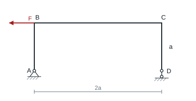

### 解答

$D$ 处只列竖向约束，$A$ 处列两个分量。对 $A$ 取矩，$2aD_y+aF=0$。再列两个方向的平衡。

**结果**　$A_x=F,A_y=F/2,D_y=-F/2$。若 $D$ 为无压紧装置的单面滚动支承，所需向下反力无法由该接触提供，需防脱约束。

## 3.2 两杆交点的斜力和竖力

### 题目

**题意**　墙上两杆在销 $C$ 会合，销同时受两个外力。

**已知条件**　$A$ 在 $B$ 正上方，$BC$ 水平，$AC$ 与竖直成 $30^\circ$。$F_1=450$ N，垂直于 $AC$ 指向右上；$F_2=550$ N，竖直向下。两杆两端铰接，忽略杆重。

**求解要求**　求两杆轴力及拉压性质。

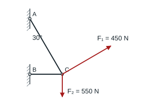

### 解答

取 $C$ 销，$AC$ 的假定拉力指向左上，$F_1$ 与 $AC$ 垂直并指向右上。

$$
N_{AC}\cos30^\circ+450\sin30^\circ-550=0,\qquad
-N_{AC}\sin30^\circ-N_{BC}+450\cos30^\circ=0.
$$

**结果**　$AC$ 拉力 375.28 N，$BC$ 拉力 202.07 N。

## 3.3 槽内的两个圆柱

### 题目

**题意**　两个等大的圆柱放在竖壁矩形槽中。

**已知条件**　槽宽 72 cm；每柱半径 20 cm、重 500 N。左柱悬在左上，与左壁在 $A$ 接触；右柱在右下，与右壁和槽底分别接触于 $B,C$。两柱相切，所有接触光滑。

**求解要求**　求 $A,B,C$ 处法向反力。

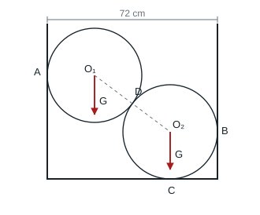

### 解答

两圆心横距 $72-40=32$ cm，圆心距 40 cm，竖距 24 cm。隔离左上圆，$D$ 的法向力竖直分量为 $0.6N_D$，水平分量的大小为 $0.8N_D$。

**结果**　$N_D=500/0.6=833.33$ N。$A$、$B$ 法向力均为 666.67 N，分别向右、向左；地面 $C$ 法向力 1000 N 向上。

## 3.4 四连杆两处结点载荷

### 题目

**题意**　四杆机构在两处活动销受力时保持平衡。

**已知条件**　机架为 $AD$，$A,D$ 为固定铰；活动杆为 $AB,BC,CD$。$F_1$ 在 $B$ 垂直 $AB$ 指向右下，与 $B\to C$ 成 $60^\circ$；$F_2$ 在 $C$ 沿 $CB,CD$ 之间的角平分线向下，与两杆各成 $45^\circ$。

**求解要求**　求平衡时 $F_1,F_2$ 的大小关系。

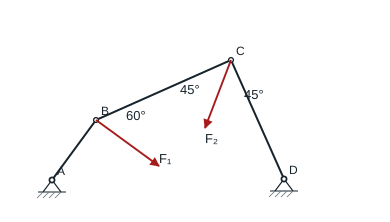

### 解答

载荷加在销上，三杆均为二力构件。沿 $F_1$ 方向投影 $B$ 销平衡，由于 $AB$ 垂直于 $F_1$，有 $F_1+N_{BC}\cos60^\circ=0$。在 $C$ 处 $F_2$ 沿两杆夹角的平分线，故 $N_{BC}=-F_2\cos45^\circ$。

**结果**　$F_2=2\sqrt2F_1$。

## 3.5 绳索拔木桩

### 题目

**题意**　用一根支绳横向拉动主绳，以拔出木桩。

**已知条件**　桩顶 $A$ 连接 $AC$，$AC$ 竖直，$CB$ 向右上且与竖直成 $30^\circ$。支绳 $CE$ 向左水平，$ED$ 向左上且与水平成 $30^\circ$。$B,D$ 固定，在 $E$ 施加竖直向下的 $F$。

**求解要求**　求桩顶获得的竖直向上拔力。

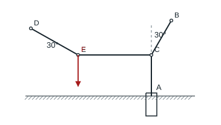

### 解答

先取 $E$，由平衡得 $T_{ED}\sin\alpha=F$、$T_{CE}=T_{ED}\cos\alpha$。再取 $C$，有 $T_{CB}\sin\alpha=T_{CE}$、$T_{AC}=T_{CB}\cos\alpha$。

**结果**　桩顶向上的拔力 $T_{AC}=F\cot^2\alpha=3F$。

## 3.6 力偶作用下的两种梁支承

### 题目

**题意**　对同一根受力偶的梁比较两种支承。

**已知条件**　梁 $AB=l$，$A$ 固定铰，逆时针力偶 $M$；(a) $B$ 为水平滚动铰；(b) $B$ 的滚动面向右上倾斜 $\theta$。忽略梁重。

**求解要求**　求两种情况下的 $A,B$ 反力。

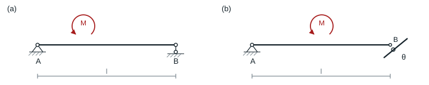

### 解答

图示 $M$ 逆时针。两子图对 $A$ 取矩均有 $B_y=-M/l$，所以 $A_y=M/l$。(a) 的 $B_x=0$。(b) 令斜面向外法线为 $(-\sin\theta,\cos\theta)$，得 $R_B=-M/(l\cos\theta)$。

**结果**　(a) $A_x=0,A_y=M/l,B_y=-M/l$。(b) $A_x=-M\tan\theta/l,A_y=M/l$，$B$ 分量为 $(M\tan\theta/l,-M/l)$。负法向值表示需要防脱才能维持这种约束。

## 3.7 两弯杆和一个力偶

### 题目

**题意**　用两根折弯杆和中间铰组成平面结构。

**已知条件**　取 $A$ 为原点，$B=(a,4a)$、$C=(2a,3a)$，各点均铰接。杆 $AB$ 自 $A$ 竖直到顶再向右，杆 $BC$ 自 $B$ 向下再向右。$AB$ 受逆时针力偶 $M$，两杆无重。

**求解要求**　求支座 $A,C$ 的反力。

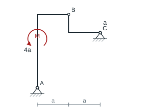

### 解答

$BC$ 是二力构件，$C$ 处反力可设为 $(K,-K)$。以 $A$ 为原点，$C=(2a,3a)$，整体的矩方程为 $M-(2a+3a)K=0$。

**结果**　$C=(M/(5a),-M/(5a))$，$A=(-M/(5a),M/(5a))$。

## 3.8 四连杆的平衡力偶

### 题目

**题意**　确定使四杆机构静止的输入力偶。

**已知条件**　$OA=0.90$ m 竖直，$AB$ 水平，$BC=0.60$ m，自 $C$ 向右上成 $45^\circ$。$O,C$ 固定铰；$BC$ 受逆时针 $M_2=2$ N·m，$OA$ 受顺时针 $M_1$。各杆无重。

**求解要求**　求 $M_1$ 和 $AB$ 的轴力。

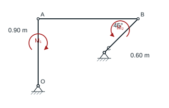

### 解答

$AB$ 是水平二力杆。取 $BC$，对 $C$ 取矩，$M_2$ 逆时针，需要 $B$ 处向右的水平力。力臂 $0.6\sin45^\circ$，故 $AB$ 受压 $2/(0.6\sin45^\circ)$。该压力在 $A$ 对 $OA$ 向左，产生逆时针力矩。

**结果**　$F_{AB}=4.714$ N（压），$M_1=0.9F_{AB}=4.243$ N·m（顺时针）。

## 3.9 中铰刚架支座 A

### 题目

**题意**　带中铰的门形刚架右半部受力偶。

**已知条件**　取 $A=(0,0)$、$B=(2l,0)$、$C=(l,l)$、$D=(-l,l)$。左构件从 $D$ 沿顶梁到 $C$，在 $A$ 以竖腿铰支；右构件从 $C$ 水平伸至 $B$ 上方再竖直下折。$D$ 接竖直短杆，$B$ 靠竖墙滚动，$C$ 是内铰。右件受顺时针力偶 $M$，自重忽略。

**求解要求**　求 $A$ 的反力分量。

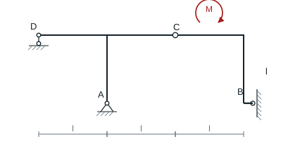

### 解答

对右半架以 $C$ 取矩，$B$ 仅有水平反力，$lB_x-M=0$。整体对 $A$ 取矩，$B_x$ 作用线通过 $A$，故 $-lD_y-M=0$。

**结果**　$A_x=-M/l,A_y=M/l$。

## 3.10 两种载荷分布下的梁

### 题目

**题意**　分别求一根斜面支承梁和一根悬臂梁的支座反力。

**已知条件**　(a) $AB=3$ m，$A$ 固定铰，$B$ 滚动面向右上倾 $45^\circ$；距 $A$ 1 m 至 $B$ 受向下均布载荷 4 kN/m，并受顺时针力偶 6 kN·m。(b) 左端 $A$ 固定、$AB=6$ m，向下三角载荷由 $A$ 的 2 kN/m 线性减至 $B$ 的零。

**求解要求**　求各支座的反力，固定端还要求反力偶。

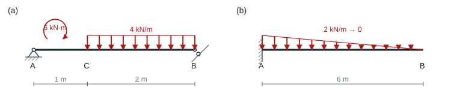

### 解答

(a) 均布荷载的合力为 8 kN，距 $A$ 为 2 m，另有顺时针 6 kN·m。$3B_y-16-6=0$，斜面法线给出 $B_x=-B_y$。

(b) 三角荷载的合力 6 kN，距固定端为 $6/3=2$ m。

**结果**　(a) $B=(-22/3,22/3)$ kN，$A=(22/3,2/3)$ kN。(b) $A_x=0,A_y=6$ kN，固定端力偶 12 kN·m 逆时针。

## 3.11 风载与偏心竖载的立柱

### 题目

**题意**　杯形基础内固结的立柱同时受风、吊车竖载和自重。

**已知条件**　柱高 12 m；向右均布风载 2.5 kN/m；吊车竖载 80 kN 向下，作用线在柱轴右侧 0.6 m；50 kN 自重沿柱轴向下。

**求解要求**　求柱脚的水平、竖直反力及反力偶。

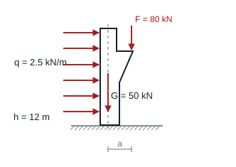

### 解答

风合力 $qh=30$ kN 向右，距柱脚 6 m。偏心竖向力的矩为 $Fa=48$ kN·m。两者同为顺时针，自重作用线通过柱轴。

**结果**　柱脚水平反力 30 kN 向左、竖向反力 $80+50=130$ kN 向上，反力偶 $30(6)+48=228$ kN·m 逆时针。

## 3.12 三铰拱

### 题目

**题意**　一对对称半拱通过拱顶铰连接。

**已知条件**　两脚 $A,B$ 是固定铰。每个半跨 $l=16$ m，拱顶高 $h=12$ m。每半拱重 350 kN，竖向重力作用线距各自的脚铰水平距离 $l/3$。

**求解要求**　求 $A,B$ 的反力。

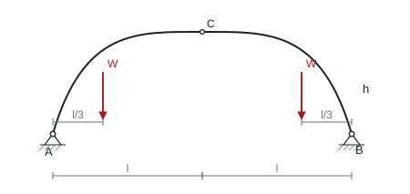

### 解答

对称给出 $A_y=B_y=W$。对左半拱以冠铰 $C$ 取矩，$hA_x-lW+(2l/3)W=0$。

**结果**　$A_y=B_y=350$ kN；$A_x=350(16)/(3\cdot12)=155.56$ kN，$B_x=-155.56$ kN，均指向跨内。

## 3.13 带拉杆的三铰屋架

### 题目

**题意**　底部有水平拉杆的对称三铰屋架承受均布载荷。

**已知条件**　跨长 $l$，冠铰 $C$ 在中跨上方 $l/6$。$A$ 为固定铰、$B$ 为竖向活动支承，两脚由拉杆 $AB$ 相连。全跨承受按水平投影计的向下均布载荷 $q$，忽略自重。

**求解要求**　求 $AB$ 拉力及冠铰 $C$ 的作用力。

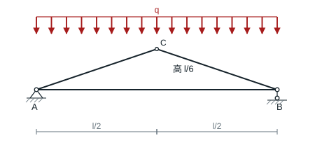

### 解答

左右支座竖向反力均为 $ql/2$，冠铰竖向分力由对称性为零。均布荷载按水平投影计。取左半架，对冠铰取矩，拉杆力臂为 $l/6$，有

$$
T(l/6)-(ql/2)(l/2)+(ql/2)(l/4)=0.
$$

**结果**　拉杆受拉 $3ql/4$，冠铰对左半架水平向左作用 $3ql/4$，对右半架反向。

## 3.14 带中间铰的复合梁

### 题目

**题意**　两根梁在 $C$ 铰接，组成有三个支承的复合梁。

**已知条件**　从左端 $A$ 量起，$B,C,D$ 分别在 $a,2a,4a$，$a=1$ m；$A$ 固定铰、$B,D$ 水平滚动铰。$x=a$ 至 $3a$ 受向下 $q=15$ kN/m，右梁受顺时针 $M=50$ kN·m。忽略梁重。

**求解要求**　求 $A,B,D$ 支反力和 $C$ 的铰接力。

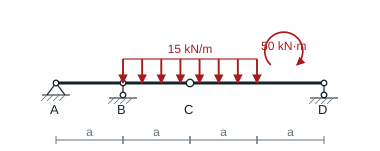

### 解答

均布荷载在 $C$ 两侧各长 1 m。取右段，以 $C$ 取矩得 $2D_y-15(0.5)-50=0$，故 $D_y=28.75$ kN、$C_y^{\rm 右}=15-D_y=-13.75$ kN。左段对 $A$ 取矩，$B_y+2(13.75)-15(1.5)=0$。

**结果**　$A_x=0,A_y=6.25$ kN，$B_y=-5$ kN，$D_y=28.75$ kN，铰力对左段向上 13.75 kN、对右段向下同值。若 $B$ 是单面接触，负值提示需压紧约束。

## 3.15 起重架和偏置滑轮

### 题目

**题意**　两杆起重架通过一只滑轮悬挂重物。

**已知条件**　墙上 $A$ 在 $B$ 正上方 800 mm。水平杆 $AD=1000$ mm，$D$ 铰于斜杆 $BE$；轮心 $E$ 比 $D$ 再向右 400 mm。滑轮直径 240 mm，绳从横杆上的 $C$ 向右上、平行于 $BE$，从轮右缘竖直下垂，吊重 20 kN。忽略其余重量。

**求解要求**　求墙上固定铰 $A,B$ 的反力。

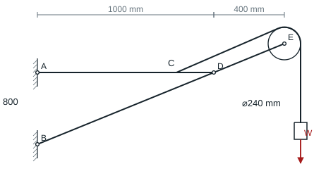

### 解答

取 $B$ 为坐标原点（m），$A=(0,0.8)$、$D=(1,0.8)$。$BE$ 斜率 $0.8$，轮心 $E$ 的横坐标 1.4，悬垂绳在轮右侧，荷载作用线 $x=1.52$。整体对 $B$ 取矩得 $-0.8A_x-20(1.52)=0$。

斜绳平行 $BE$，到轮心的法向距离为 0.12 m，故其直线为 $y-0.8x=0.12\sqrt{1+0.8^2}$。在 $C$ 处 $y=0.8$，得 $x_C=0.80791$ m。绳对上杆的竖分量为 $T_y=20(0.8)/\sqrt{1+0.8^2}=12.4939$ kN。上杆关于 $A$ 的平衡给出 $D_y=-x_C T_y$，因而 $A_y=-T_y-D_y$。

**结果**　$A=(-38,-2.40)$ kN，$B=(38,22.40)$ kN。

## 3.16 双滑轮支架

### 题目

**题意**　水平杆和斜撑组成的支架上安装两只等径滑轮。

**已知条件**　取 $A=(0,4)$、$C=(0,0)$、$D=(2,4)$、$B=(4,4)$，坐标单位为 m。两轮半径 0.6 m；绳从斜撑上的 $E$ 竖直上行，绕过 $D$、水平跨至 $B$，再由 $B$ 右缘下垂，吊重 4 kN。

**求解要求**　求墙上固定铰 $A,C$ 的反力。

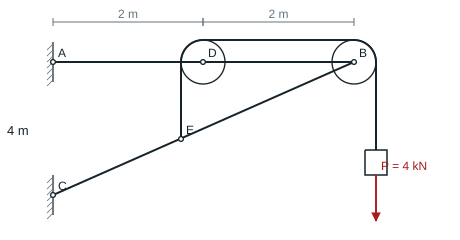

### 解答

两轮绳力相等，$D$ 轮向右和向下各受 4 kN，$B$ 轮向左和向下各受 4 kN，绳端在斜杆 $E$ 处向上拉 4 kN。整体等效外载沿最右绳段 $x=4.6$ m 向下。对 $C$ 取矩给出 $-4A_x-4(4.6)=0$。

对横杆 $AB$ 以 $A$ 取矩，斜杆对横杆在 $B$ 处的竖向作用 $B_y$ 满足 $4B_y-4(2)-4(4)=0$，故 $B_y=6$ kN、$A_y=8-6=2$ kN。

**结果**　$A=(-4.60,2.00)$ kN，$C=(4.60,2.00)$ kN。
