# 第 4 章 桁架、摩擦与重心

教材第 64–67 页。桁架轴力以拉为正，力矩以逆时针为正。

## 4.1 塔架中部三杆

### 题目

**题意**　五节等宽等高的塔式桁架顶端受水平力。

**已知条件**　每节为边长 $l$ 的正方形，斜杆由每节左下接至右上。左脚为固定铰、右脚为竖向活动支承。右上角受向右的 $F$。中间节的左竖杆、斜杆、右竖杆分别编号 1、2、3。

**求解要求**　求三根指定杆的轴力。

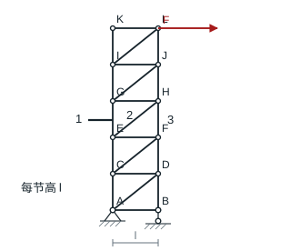

### 解答

截断中间节间的 1、2、3 杆，取上部。2 杆与水平成 $45^\circ$。以该节间右上节点为矩心，$F$ 的力臂为 $2l$。

$$
\sum F_x=F-N_2/\sqrt2=0,\qquad
\sum M=N_1l-2Fl=0,\qquad
\sum F_y=-N_1-N_2/\sqrt2-N_3=0.
$$

**结果**　$N_1=2F$（拉），$N_2=\sqrt2F$（拉），$N_3=-3F$（压）。

## 4.2 上弦连续桁架

### 题目

**题意**　双排节点的桁架在两个下弦节点受竖载。

**已知条件**　上下排从左到右分别为 $A,B,C,D,E$ 与 $K,J,I,H,G$。各节宽 1 m、高 1 m；上下弦、五根竖杆及 $AJ,CJ,CH,EH$ 连接。$J$ 固定铰，$G$ 竖向活动支承。$K,H$ 分别向下受 10、20 kN。

**求解要求**　求 $CJ,HI,HD$ 的杆力。

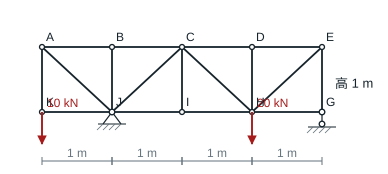

### 解答

以 $J$ 为矩心，$K$ 的 10 kN 向下荷载在左侧 1 m，$H$ 的 20 kN 荷载在右侧 2 m，$G$ 在右侧 3 m。因此 $10-40+3G_y=0$，得到 $G_y=10$ kN、$J_y=20$ kN。节点 $D$ 无外荷载且相邻两根上弦共线，$HD$ 为零杆。

截断 $BC,CJ,JI$ 并取左部。竖向平衡 $20-10+N_{CJ}/\sqrt2=0$。对 $C$ 取矩，$BC,CJ$ 两力过矩心，$K,J$ 的外力矩分别为 $20,-20$ kN·m，故 $N_{JI}=0$。由节点 $I$ 的水平平衡，$N_{HI}=N_{JI}$。

**结果**　$CJ$ 受压 $10\sqrt2$ kN，$HI=HD=0$。

## 4.3 中铰组合桁架

### 题目

**题意**　两个三角形分片桁架以跨中铰 $G$ 相连。

**已知条件**　以 m 为单位，左侧 $A(0,0),B(0,1),D(0,2),C(1,1),E(1,2),G(2,2)$，右侧镜像，脚点为 $L(4,0)$。$A$ 固定铰，$L$ 竖向活动支承。$D,G,I$ 各受向下 50 kN，$D$ 左向、$I$ 右向各受 30 kN。

**求解要求**　求左分片中 $EG,CG$ 的轴力。

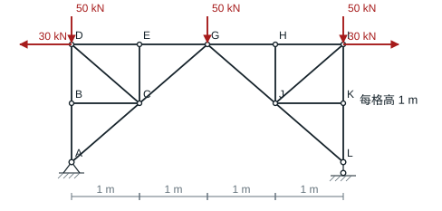

### 解答

整体的两个 30 kN 水平力等高、反向；三处 50 kN 竖向荷载关于跨中对称。故 $A_x=0$、$A_y=L_y=75$ kN。切断 $EG,CG$，取不含节点 $G$ 的左部，$CG$ 在左部的假定拉力向右上。

$$
75-50+N_{CG}/\sqrt2=0,\qquad -30+N_{EG}+N_{CG}/\sqrt2=0.
$$

**结果**　$EG$ 受拉 55 kN，$CG$ 受压 $25\sqrt2$ kN。

## 4.4 两根边竖杆

### 题目

**题意**　三排节点的桁架左上端承受水平载荷。

**已知条件**　从左到右，上排 $A,B,C,D,E$，中排 $G,H,I,J,K$，底排 $L,M,N,O,P$；横竖网格 1 m。除三层横杆外，竖杆为 $AG,GL,HM,CI,JO,EK,KP$，斜杆为 $GB,BI,ID,DK,LH,HN,NJ,JP$。$L$ 固定铰、$P$ 竖向活动支承；$A$ 向右受 20 kN。

**求解要求**　求边竖杆 $GL,KP$ 的轴力。

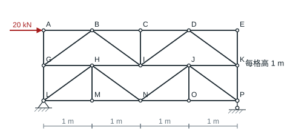

### 解答

$A,C,E$ 三处分别由节点平衡得到 $AG=0$、$CI=0$、$DE=EK=0$。设 $N_{GB}=T$，由 $B,I,D$ 的竖向平衡依次得到 $N_{BI}=-T$、$N_{ID}=T$、$N_{DK}=-T$。

取上排五个节点及相连上弦。四根斜杆在其上的水平分量都为 $-T/\sqrt2$，所以 $20-4T/\sqrt2=0$。在 $G,K$ 处分别列竖向平衡，得到 $N_{GL}=T/\sqrt2$、$N_{KP}=-T/\sqrt2$。

**结果**　$GL$ 受拉 5 kN，$KP$ 受压 5 kN。

## 4.5 方形外框中的三根指定杆

### 题目

**题意**　方形外框桁架在内部节点 $G$ 受集中力。

**已知条件**　外框 $A(0,0),B(l,0),C(0,l),D(l,l)$，内部 $E(l/3,l/2),G(2l/3,l/2)$。除外框四边外，内杆为 $AE,EB,EG,CG,DG$。$A$ 固定铰、$B$ 竖向活动支承；$F$ 竖直向下作用于 $G$。1、2、3 号杆分别为 $CD,DB,EG$。

**求解要求**　求三根编号杆的轴力。

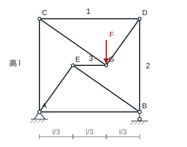

### 解答

截断 $AC$、杆 2、杆 3，取上半部。杆 3 是唯一的水平力，故 $N_3=0$。对 $C$ 取矩，$-F(2l/3)-N_2l=0$，即 $N_2=-2F/3$。

在 $D$ 节点，$DG$ 向左、下的方向余弦为 $2/\sqrt{13},3/\sqrt{13}$。竖向平衡得 $N_{DG}=2\sqrt{13}F/9$，水平平衡得 $N_1=-2N_{DG}/\sqrt{13}$。

**结果**　$N_1=-4F/9$，$N_2=-2F/3$，$N_3=0$。

## 4.6 交错纸本

### 题目

**题意**　两本纸的单张纸逐页交错，拉动其中一本时层间发生滑动。

**已知条件**　共有 500 张，每张重 0.05 N；纸间及纸与桌面间的静摩擦系数均为 0.1。左、右封接成 $A,B$ 两本，底张属于 $A$，其中一本固定。

**求解要求**　求开始抽动另一整本的水平力，分别考虑固定 $A$ 和固定 $B$。

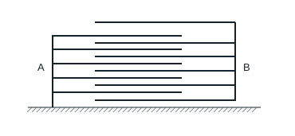

### 解答

自顶向下，第 $j$ 个纸间界面承受上面 $j$ 张纸的重量。每个界面连接两本不同的纸本，抽出一本时各界面均发生相对滑动。

$$
F_{\rm paper}=0.1(0.05)\sum_{j=1}^{499}j=623.75\ \mathrm N.
$$

按题图底张属于 $A$。固定 $A$、抽 $B$ 时仅需上式；固定 $B$、抽 $A$ 时还要克服桌面的 $0.1(500)(0.05)=2.50$ N。

**结果**　抽 $B$ 需 623.75 N，抽 $A$ 需 626.25 N。

## 4.7 三个相同圆柱

### 题目

**题意**　两只圆柱并排着地，第三只对称地叠在上方。

**已知条件**　三个圆柱均质、等大、等重，圆心形成等边三角形。下柱 $A,B$ 相接但互不挤压；柱与地、柱与柱的静摩擦系数分别为 $\mu_{\rm 地},\mu_{\rm 柱}$。

**求解要求**　求保持堆叠平衡所需的两个最小摩擦系数。

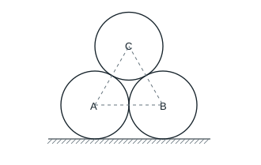

### 解答

设每个重量 $W$。下方两柱互相无挤压。以左下柱为对象，上接触法向力指向左下，切向摩擦指向右下，地面摩擦指向右。对左下柱圆心取矩，两处摩擦大小相同为 $f$。水平方向给出 $N/2=f+(\sqrt3/2)f$。

顶部柱的竖向平衡为 $\sqrt3N+f=W$，故 $N=W/2$、$f=(2-\sqrt3)W/2$。每个底柱的地面法向力为 $3W/2$。

**结果**　$\mu_{\rm 地}\ge(2-\sqrt3)/3\approx0.0893$，$\mu_{\rm 柱}\ge2-\sqrt3\approx0.268$。

## 4.8 砖夹

### 题目

**题意**　双臂砖夹夹住砖的两侧并向上提起。

**已知条件**　砖宽 300 mm、重 $W$；夹杆 $AGB$ 和 $GCDE$ 在 $G$ 铰接。提力 $T$ 向上、通过砖的中线；$G$ 距左夹持面水平 50 mm，$l$ 为 $G$ 到等高法向夹力作用线的竖距。两侧静摩擦系数 0.3。

**求解要求**　求砖可被提起时 $l$ 的范围。

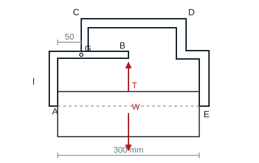

### 解答

整体缓慢起吊时 $T=W$。隔离砖块，两侧等高的法向力均为 $N$，摩擦均为 $f=W/2$ 且向上。对夹杆 $AGB$，砖对夹杆的摩擦向下。以 $G$ 为矩心，$T$ 与摩擦的力臂分别为 100 mm、50 mm。

$$
100T+50f-Nl=0,\qquad Nl=125W,\qquad W/2\le0.3N.
$$

**结果**　$0<l\le75$ mm。

## 4.9 车轮前的圆形障碍

### 题目

**题意**　购物车的轮子被着地的圆形障碍挡住。

**已知条件**　车轮半径 $R=90$ mm，障碍半径 $r$。障碍与地面、与轮缘分别在 $A,B$ 接触，两处静摩擦系数均为 $1/3$，障碍物自重忽略。

**求解要求**　求仍能阻止车轮转动的最大障碍半径。

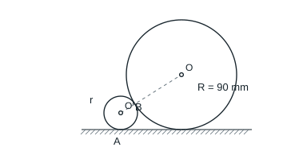

### 解答

忽略障碍物自重，障碍物只有地面 $A$ 和车轮 $B$ 两处接触合力，故两合力沿 $AB$。设两圆心连线对水平倾角为 $\phi$，则 $\sin\phi=(R-r)/(R+r)$。$AB$ 与 $A$ 处法线的夹角为 $\gamma$，由圆的几何关系 $\tan\gamma=\cos\phi/(1+\sin\phi)=\sqrt{r/R}$；$B$ 处同样需要这一摩擦角。

**结果**　$\sqrt{r/R}\le1/3$，所以 $r_{\max}=R/9=10$ mm。

## 4.10 偏心凸轮顶杆

### 题目

**题意**　偏心凸轮将竖直顶杆向上推，导轨摩擦可能导致卡滞。

**已知条件**　凸轮受力偶 $M$，对顶杆的接触力为竖直力，作用线相对凸轮转轴偏心 $e$。顶杆受向下的 $F$；导轨上下接触边缘相距 $d$，静摩擦系数 $\mu_s$。凸轮与杆的接触无摩擦。

**求解要求**　求可使顶杆上行的导轨长度条件。

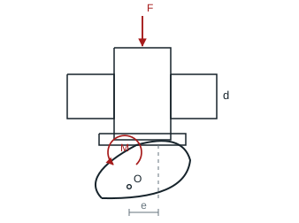

### 解答

凸轮平衡给出向上顶力 $P=M/e$。顶杆偏心受力使导轨上下边缘产生大小相同、方向相反的法向力 $N$。临界向上时两处摩擦均向下，对杆轴中心取矩得 $Nd=Pe=M$。上滑条件为 $P>F+2\mu_s N$。

**结果**　必须有 $M/e>F$，且 $d>2\mu_s M/(M/e-F)$。等号为上滑临界；无竖向外荷载时化为 $d>2\mu_s e$。

## 4.11 钢箍夹紧木条

### 题目

**题意**　两个相反受拉的搭接木条由一只矩形钢箍夹紧。

**已知条件**　木条与木条、木条与钢箍间的静摩擦系数均为 0.2，各接触面同时临界滑动。拉力为 500 N；外侧接触面间竖直厚度 110 mm，箍的净宽 130 mm、木条宽 120 mm。

**求解要求**　求能阻止滑动的钢箍最大尺寸 $h$。

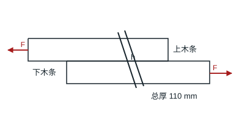

### 解答

上、下木条相反方向运动。钢箍上下接触合力为等大反向的二力，其连线对竖直的最大倾角 $\theta$ 满足 $\tan\theta=\mu=0.2$。上下接触点的竖向距离为 110 mm，沿箍的间距为 $h$。对单块木条，两处接触的法向力大小相同，临界时 $F=2\mu N$，故 $N=1250$ N。

**结果**　$h_{\max}=110/\cos\theta=110\sqrt{1+0.2^2}\approx112.18$ mm。

## 4.12 滚子与滑动搬运

### 题目

**题意**　用钢管作滚子搬运木箱，并与在木板上直接拖动比较。

**已知条件**　箱重 800 N；钢管直径 40 mm，钢管与木板、与箱底的滚动摩阻系数均为 0.2 cm。直接拖动时木板与箱底的静滑动摩擦系数 0.3。

**求解要求**　求两种方式各需的临界水平推力。

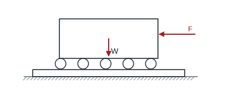

### 解答

每根滚子上下两处的滚动摩阻矩同向，合为 $2N_i\delta$。上下切向力构成的力偶为 $T_id$。求和后 $\sum N_i=W$，所以 $F=2W\delta/d$。

**结果**　有滚子时 $F=2(800)(2)/40=80$ N。直接滑动时 $F=0.3(800)=240$ N。

## 4.13 不同密度的组合体

### 题目

**题意**　求竖条和横条拼成的两个等厚组合体的重心。

**已知条件**　两条尺寸均为 $10\times50$ cm，密度 $\rho_2=2\rho_1$。原点 $O$ 在竖条左边的中点，$x$ 向右、$y$ 向上；竖条从 $x=0$ 至 10 cm、$y=-25$ 至 25 cm。两种横条均从 $x=10$ 至 60 cm，(a) 以 $y=0$ 为中线，(b) 底边与竖条底边齐平。

**求解要求**　求两种组合体的重心坐标。

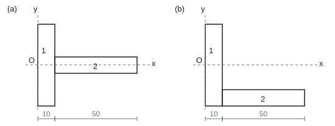

### 解答

两矩形等厚且等面积，质量比为 $1:2$。以图中 $O$ 为原点，两部分重心的 $x$ 坐标分别为 $5,35$ cm，故 $x_C=(5+2\cdot35)/3=25$ cm。左图两块的 $y$ 坐标均为零；右图分别为 $0,-20$ cm。

**结果**　左图 $(25,0)$ cm，右图 $(25,-40/3)$ cm。

## 4.14 有偏心圆孔的圆板

### 题目

**题意**　圆板左半部开有偏心圆孔。

**已知条件**　外圆以 $O$ 为圆心，半径 300 mm。孔径 240 mm，孔心在 $O$ 左方 150 mm，两个圆心同高。

**求解要求**　以 $O$ 为原点求剩余圆板的形心。

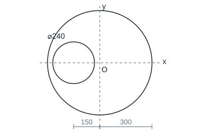

### 解答

用负面积法。外圆半径 300 mm，孔半径 120 mm，孔心在 $(-150,0)$ mm。关于水平轴对称，$y_C=0$。

**结果**　$x_C=120^2(150)/(300^2-120^2)=28.57$ mm，位于 $O$ 右侧。

## 4.15 组合工字形截面

### 题目

**题意**　工字形截面底部加焊一条更宽的板。

**已知条件**　以腹板中心为原点。腹板厚 10 mm、净高 100 mm；上下翼缘均为 $100\times10$ mm；下翼缘外侧还有一块 $140\times10$ mm 的对称底板。

**求解要求**　求组合截面形心坐标。

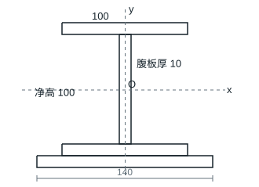

### 解答

关于 $y$ 轴对称，$x_C=0$。将截面分为上翼缘、腹板、下翼缘和加宽底板。面积依次为 $1000,1000,1000,1400$ mm²，重心的 $y$ 坐标为 $55,0,-55,-65$ mm。

**结果**　$y_C=\sum A_i y_i/\sum A_i=-91000/4400=-20.68$ mm。
