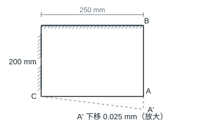

# 第 5 章 材料力学基础

教材第 74 页。

## 5.1 薄板边的应变和夹角

### 题目

**题意**　薄板两邻边固定，右下角发生小位移。

**已知条件**　初始为宽 250 mm、高 200 mm 的矩形，右下角为 $A$、右上角为 $B$、左下角为 $C$。$A$ 竖直下移 0.025 mm，$B,C$ 固定，变形后 $AB,AC$ 保持直线。

**求解要求**　求 $AB$ 平均线应变及两边夹角的变化。

### 解答

$AB$ 原长 200 mm，$A$ 下移 0.025 mm 后 $AB$ 沿原方向伸长。$AC$ 的水平投影 250 mm 不变，变形后与水平线成 $\arctan(0.025/250)$。由 $A'$ 向 $C$ 和 $B$ 观察，原直角减小。

**结果**　$\bar\varepsilon_{AB}=0.025/200=1.25\times10^{-4}$。夹角变化 $\Delta\angle BAC=-\arctan(10^{-4})\approx-10^{-4}$ rad。
