# 第 6 章 轴向拉伸与压缩

教材第 105–107 页。轴力拉正压负。用 N、mm 时，$1\ \mathrm{MPa}=1\ \mathrm{N/mm^2}$。

## 6.1 四根杆的轴力图

### 题目

**题意**　按集中载荷作用点把四根直杆分段。

**已知条件**　自左到右：(a) 自由杆 $A,B,C$ 依次受 $F$ 向左、$3F$ 向右、$2F$ 向左；(b) $A$ 固定，$B,C$ 依次受 $4F$ 向右、$3F$ 向左；(c) $A$ 固定，$B$ 向左 50 kN，$C$ 向右 30 kN；(d) $A$ 固定，$B,C,D$ 依次受向右 30 kN、向左 20 kN、向右 10 kN。

**求解要求**　求各段轴力并画轴力图。

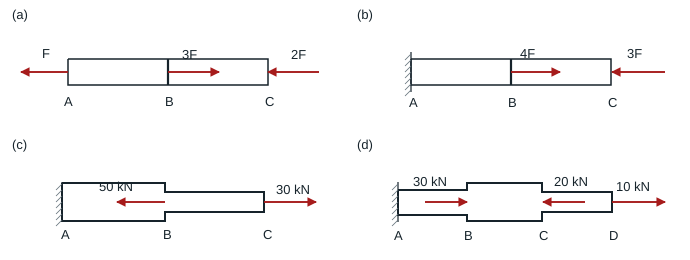

### 解答

分段截开并取右侧，轴力为截面右方外力的代数和（右向为正）。

| 子图 | $N_{AB}$ | $N_{BC}$ | $N_{CD}$ |
|---|---:|---:|---:|
| a | $3F-2F=F$ | $-2F$ | — |
| b | $4F-3F=F$ | $-3F$ | — |
| c | $-50+30=-20$ kN | $+30$ kN | — |
| d | $30-20+10=20$ kN | $-20+10=-10$ kN | $+10$ kN |

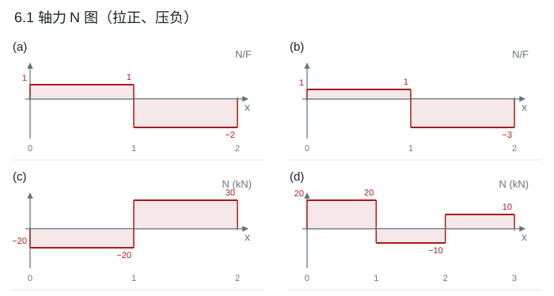

**结果**　表中每段为常值，集中力处发生跳变。(b)、(c)、(d) 的左端反力依次为 $-F,+20,-20$，后两项单位为 kN。图中横坐标按段编号示意。

## 6.2 两截面等应力

### 题目

**题意**　在阶梯杆两处施加轴向力，调节二者比例使两段横截面正应力相同。

**已知条件**　左端 $A$ 固定，台阶 $B$ 与右端 $C$ 分别受 $F_1,F_2$，两者均以向右为正。按文字给定，$AB,BC$ 直径分别为 30、60 mm，示意图画出了相反的粗细关系。

**求解要求**　求带符号的 $F_1/F_2$。

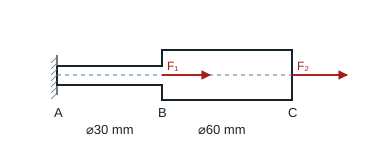

### 解答

按题面 $d_1=30$ mm、$d_2=60$ mm，故 $A_1/A_2=1/4$。分别取截面右侧，得到 $\sigma_{AB}=(F_1+F_2)/A_1$、$\sigma_{BC}=F_2/A_2$。

**结果**　令两应力相等，$F_1/F_2=A_1/A_2-1=-3/4$。若 $F_2$ 指向右，则 $F_1$ 需指向左。若依示意图互换两段直径，$A_1/A_2=4$，所得 $F_1/F_2=3$。

## 6.3 斜截面应力

### 题目

**题意**　受拉直杆上取一斜截面。

**已知条件**　两端沿杆轴相反方向各拉 20 kN，横截面面积 2000 mm²。所切斜面与杆轴成 $45^\circ$，取右侧杆段分析。

**求解要求**　求斜面正应力和切应力。

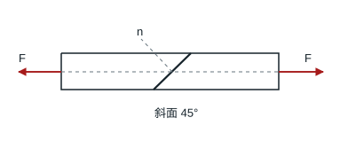

### 解答

横截面拉应力 $F/A=20000/2000=10$ MPa。法线与轴向夹角为 $45^\circ$，斜截面面积 $A_\theta=A/\cos\theta$，法向和切向分力分别为 $F\cos\theta$ 和 $F\sin\theta$。

**结果**　$\sigma_\theta=(F/A)\cos^2\theta=5$ MPa（拉），$|\tau_\theta|=(F/A)\sin\theta\cos\theta=5$ MPa。取右段时剪应力沿截面向左下。

## 6.4 两杆桁架的许用载荷

### 题目

**题意**　墙铰支承的两根杆在 $C$ 承受竖载。

**已知条件**　$A$ 在 $B$ 正上方，杆 1 为自 $A$ 向右下的 $AC$，与水平杆 2（$BC$）成 $45^\circ$。$C$ 受向下的 $F$，两杆面积均为 100 mm²，许用拉、压应力分别为 150、200 MPa。

**求解要求**　求 $F$ 的许用值。

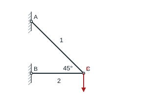

### 解答

节点 $C$ 竖向平衡 $N_1\sin45^\circ=F$，水平平衡 $-N_1\cos45^\circ-N_2=0$。故 $N_1=\sqrt2F$，$N_2=-F$。杆 1 拉力限值 $150(100)=15$ kN，杆 2 压力限值 $200(100)=20$ kN。

**结果**　$[F]=\min(15/\sqrt2,20)=10.61$ kN，由杆 1 控制。

## 6.5 对称高度、不同杆角的桁架

### 题目

**题意**　两根斜吊杆将荷载传至同一水平面的两个上铰。

**已知条件**　载荷 100 kN 竖直向下作用于 $B$。左杆 1、右杆 2 与竖直分别成 $45^\circ,30^\circ$。杆 1 为直径 30 mm 的圆，杆 2 为边长 20 mm 的正方形；许用应力均为 200 MPa。

**求解要求**　求各杆正应力并校核强度。

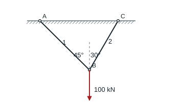

### 解答

取载荷节点 $B$。两杆与竖直夹角分别 $45^\circ,30^\circ$。水平平衡 $N_1\sin45^\circ=N_2\sin30^\circ$，竖直平衡 $N_1\cos45^\circ+N_2\cos30^\circ=100$ kN。解得 $N_1=51.76$ kN、$N_2=73.21$ kN。

**结果**　$\sigma_1=51.76\times10^3/(\pi30^2/4)=73.23$ MPa，$\sigma_2=73.21\times10^3/20^2=183.01$ MPa，均小于 200 MPa。

## 6.6 阶梯杆伸长

### 题目

**题意**　阶梯形直杆在两端及台阶处受三支轴向力。

**已知条件**　从左到右 $AB=BC=100$ mm，截面积分别为 100、50 cm²，$E=200$ GPa。$A$ 向左 40 kN，$B$ 向右 60 kN，$C$ 向左 20 kN。

**求解要求**　求 $AB$ 的横截面正应力及 $AC$ 的总伸长量。

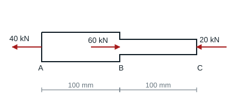

### 解答

$N_{AB}=60-20=40$ kN，$N_{BC}=-20$ kN。$A_1=10000$ mm²，$A_2=5000$ mm²，$E=200000$ MPa，两段均长 100 mm。

**结果**　$\sigma_{AB}=4.00$ MPa（拉）。用 $\Delta L=NL/(EA)$ 分别得到 $+0.002$ mm、$-0.002$ mm，故总伸长为零。

## 6.7 两杆桁架的节点位移

### 题目

**题意**　在 6.4 两杆体系中计算节点的弹性位移。

**已知条件**　杆 1 斜向下接 $C$，与水平杆 2 成 $45^\circ$；$A,B$ 固定铰，$BC=1$ m，$C$ 受向下的 $F$。$A_1=100$ mm²、$A_2=150$ mm²、$E=200$ GPa。

**求解要求**　求 $C$ 的水平和竖直位移。

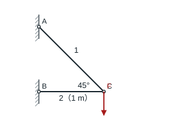

### 解答

沿用 6.4 的轴力，$L_1=\sqrt2(1000)$ mm、$L_2=1000$ mm。设 $C$ 的水平、竖向位移 $u,v$ 以右、上为正，$F$ 以 N 计。

$$
u=\Delta L_2=-\frac{F}{30000}\ \mathrm{mm},\qquad
\frac{u-v}{\sqrt2}=\Delta L_1=\frac{F}{10000}\ \mathrm{mm}.
$$

**结果**　$u=-F/30000$ mm，$v=-F(1/30000+\sqrt2/10000)$ mm。

## 6.8 两端固定直杆

### 题目

**题意**　两端固定的直杆受一对大小不同、方向相反的轴向载荷。

**已知条件**　$AB=BC=CD=l$，各段同面积 $A$、同材料。$A,D$ 固定，$B$ 向左受 $F$，$C$ 向右受 $3F$。

**求解要求**　求最大拉应力和最大压应力。

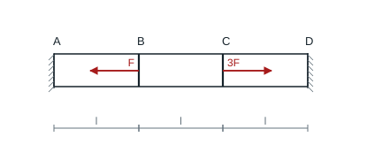

### 解答

以向右为正设 $A$ 端反力 $R_A$。由左段平衡得到三个轴力 $-R_A,F-R_A,-2F-R_A$。等截面、等段长且两端固定，$\sum N_i l/(EA)=0$，故 $R_A=-F/3$。

**结果**　三段轴力为 $F/3,4F/3,-5F/3$；最大拉应力 $4F/(3A)$，最大压应力的大小 $5F/(3A)$。

## 6.9 刚梁悬挂的平行三杆

### 题目

**题意**　三根不同刚度的平行吊杆悬住一根刚梁。

**已知条件**　杆 1、2、3 依次接在 $A,B,C$，间距均为 $a$。各杆面积 $A$、长度 $l$；弹性模量分别为 $E,2E,4E$。载荷 $F$ 竖直向下作用于 $BC$ 中点 $D$。

**求解要求**　求三杆轴力。

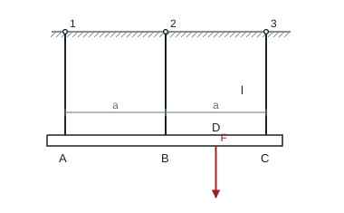

### 解答

三个刚度之比为 $1:2:4$。设 $k=EA/l$，横梁中点位移等于两端位移的平均值。

$$
N_1+N_2+N_3=F,\qquad N_2+2N_3=3F/2,\qquad
2N_2/(2k)=N_1/k+N_3/(4k).
$$

**结果**　$N_1=3F/26$、$N_2=7F/26$、$N_3=8F/13$，均受拉。

## 6.10 刚梁、两竖杆与一斜杆

### 题目

**题意**　两竖杆、一斜杆和一刚梁组成约束体系。

**已知条件**　刚梁左端 $B$、右端 $A$，中点受 50 kN 向下荷载；竖杆 1、3 分别接于 $B,A$，长度均为 1 m。斜杆 2 从左上铰接至 $A$，与梁成 $30^\circ$。各杆 $A=200$ cm²、$E=200$ GPa，屈服极限 280 MPa、强度极限 460 MPa。

**求解要求**　求三杆线应变以及 $B$ 的水平、竖直和合位移。

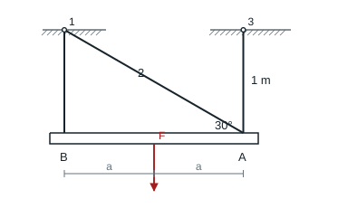

### 解答

只有斜杆 2 有水平分力，故 $N_2=0$。中点荷载给出 $N_1=N_3=F/2=25$ kN。$A=20000$ mm²，$E=200000$ MPa，故 $\varepsilon_1=\varepsilon_3=6.25\times10^{-6}$，$\varepsilon_2=0$。两根等长竖杆伸长相同，刚梁无一阶转角，两个下端具有相同平移。

斜杆从上端指向右下端的单位向量为 $(\cos30^\circ,-\sin30^\circ)$。由零伸长条件 $u\cos30^\circ-v\sin30^\circ=0$。竖杆伸长 $0.00625$ mm，故 $v=-0.00625$ mm。

**结果**　$B$ 水平左移 $0.00361$ mm，竖直下移 $0.00625$ mm，总位移 $0.00722$ mm。

## 6.11 木榫挤压和剪切

### 题目

**题意**　两个带钩榫的木件受拉，通过榫的竖直接触面传力。

**已知条件**　两端各向外拉 20 kN，木件高 60 mm、宽 60 mm；中央竖直受压面高 20 mm，两侧各有长 40 mm 的剪切段。许用挤压应力 10 MPa，许用切应力 6 MPa。

**求解要求**　校核榫接的挤压和剪切强度。

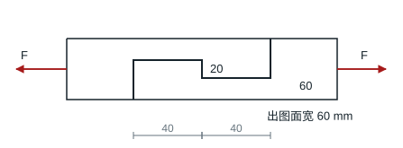

### 解答

中央竖直接触面承受全部 20 kN，挤压面积 $20\times60=1200$ mm²。左右榫的根部各有一个 $40\times60$ mm² 剪切面，任一榫均传递全部载荷。

**结果**　$\sigma_{\rm bs}=20000/1200=16.67$ MPa 超过 10 MPa；$\tau=20000/2400=8.33$ MPa 超过 6 MPa。两项均不满足。
