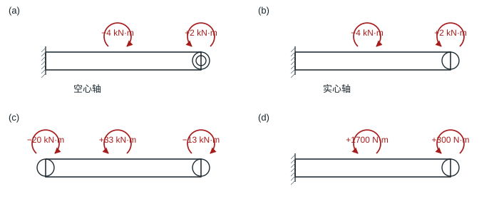
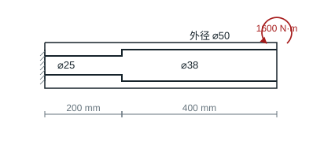
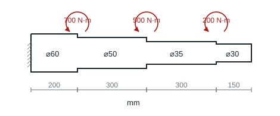
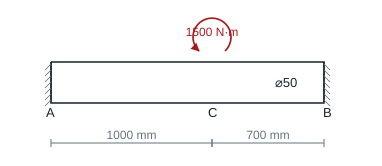

# 第 7 章 圆轴扭转

教材第 120–121 页。圆轴用 $J=\pi(D^4-d^4)/32$、$\tau_{\max}=|T|D/(2J)$、$\theta=T/(GJ)$，功率关系 $P=2\pi nT/60$。

## 7.1 四种扭矩图

### 题目

**题意**　对四个在不同截面施加力偶的圆轴逐段分析。

**已知条件**　统一从右端朝左看，每小题把右端 2 kN·m（a、b）、中间 33 kN·m（c）、中间 1700 N·m（d）的图示方向定义为该题正向。按此约定，(a) 左固空心轴，沿轴有 $-4,+2$ kN·m；(b) 左固实心轴，同样为 $-4,+2$ kN·m；(c) 自由轴左、中、右依次为 $-20,+33,-13$ kN·m；(d) 左固轴中间、右端分别为 $+1700,+300$ N·m。

**求解要求**　求各段扭矩并画扭矩图。

### 解答

从左至右逐段切开，内扭矩取截面右侧外力偶的代数和。各图正方向分别取 (a)、(b) 的右端 2 kN·m、(c) 的中间 33 kN·m、(d) 的 1700 N·m 所指方向。

| 子图 | 左段 | 右段 | 单位 |
|---|---:|---:|---|
| a | $2-4=-2$ | $+2$ | kN·m |
| b | $2-4=-2$ | $+2$ | kN·m |
| c | $33-13=+20$ | $-13$ | kN·m |
| d | $1700+300=+2000$ | $+300$ | N·m |

**结果**　扭矩图由各段常值和集中力偶处的跳变构成，横坐标按段编号示意。空心或实心不影响本题由平衡求出的扭矩。

## 7.2 实心圆轴最大切应力

### 题目

**题意**　校核 7.1(c) 实心轴的最大扭转切应力。

**已知条件**　轴直径 120 mm，左、中、右截面力偶依次为 $-20,+33,-13$ kN·m。

**求解要求**　求轴上的最大切应力。

### 解答

7.1(c) 的最大扭矩绝对值为 20 kN·m，危险截面在左段。$d=0.12$ m，实心轴抗扭截面系数 $W_t=\pi d^3/16$。

**结果**　$\tau_{\max}=20\,000/W_t=58.95$ MPa。

## 7.3 内孔变化的传动轴

### 题目

**题意**　外径不变的传动轴有两段不同直径的内孔。

**已知条件**　轴长 600 mm、外径 50 mm，左段 200 mm、孔径 25 mm，右段 400 mm、孔径 38 mm。左端固定、右端输入扭矩 1600 N·m。

**求解要求**　求最大切应力，指出危险段。

### 解答

各段均传递 $1600$ N·m，外径 50 mm 不变。分别用内径 25 mm、38 mm 求极惯性矩。

**结果**　两段外缘最大切应力分别为 69.54 MPa、97.83 MPa，危险段为内孔 38 mm 的一段。

## 7.4 实心阶梯轴

### 题目

**题意**　左端固定的实心阶梯轴在三个变径处受力偶。

**已知条件**　从左到右四段长度为 200、300、300、150 mm，直径为 60、50、35、30 mm。三个台阶从左到右受同向力偶 700、500、200 N·m；右端无外力偶。$G=70$ GPa。

**求解要求**　求全轴最大切应力及右端相对固定端的转角。

### 解答

取图中各外力偶共同的方向为正。由右侧力偶求得自左向右各段扭矩 $1400,700,200,0$ N·m。对应直径 $60,50,35,30$ mm，长度 $200,300,300,150$ mm。用 $\tau_{\max}=16T/(\pi d^3)$ 得各段 $33.01,28.52,23.76,0$ MPa。

**结果**　最大切应力 33.01 MPa。右端相对固定端扭转角 $\sum T_i L_i/(GJ_i)=0.01385$ rad，即 $0.794^\circ$，与所取正方向相同。

## 7.5 两个转速的传动功率

### 题目

**题意**　按切应力限值确定实心圆轴在两个转速下的传动能力。

**已知条件**　低碳钢轴直径 20 mm、长 200 mm，许用切应力 70 MPa。转速分别为 200、500 r/min。

**求解要求**　求两个转速各自的最大传递功率。

### 解答

$d=0.020$ m，$T_{\rm lim}=[\tau]\pi d^3/16=109.96$ N·m。

**结果**　在 200、500 r/min 时分别可传递 2.303、5.757 kW。

## 7.6 大型空心轴最小壁厚

### 题目

**题意**　同时满足强度和扭转刚度，确定空心轴壁厚。

**已知条件**　外径 350 mm，功率 7 MW，额定转速 120 r/min，$G=70$ GPa；许用切应力 125 MPa，每米许用扭转角 $1^\circ$。

**求解要求**　求最小壁厚。

### 解答

额定扭矩 $T=7\times10^6(60)/(2\pi120)=5.5704\times10^5$ N·m。外半径 $0.175$ m。强度要求 $J\ge TD/(2[\tau])=7.799\times10^{-4}$ m⁴；刚度要求 $J\ge T/(G[\theta])\approx4.560\times10^{-4}$ m⁴，其中 $[\theta]=\pi/180$ rad/m。

**结果**　强度控制。令 $\pi(D^4-d^4)/32=7.799\times10^{-4}$ m⁴，得到 $d\approx289.90$ mm、$t_{\min}\approx30.05$ mm。

## 7.7 发动机和变速箱输出轴

### 题目

**题意**　由发动机的功率和转速求扭矩，并据此选输出轴直径。

**已知条件**　最大功率 220 kW、对应转速 5000 r/min，$G=80$ GPa，许用切应力 70 MPa；输出轴为实心圆轴。变速箱传动比为 2:1，按输出转速减半、功率无损处理。

**求解要求**　求发动机扭矩、发动机输出轴最小直径和变速箱输出轴最小直径。

### 解答

$T=P(60)/(2\pi n)=420.17$ N·m。按实心轴强度，$d_{\min}=[16T/(\pi[\tau])]^{1/3}$。变速比 $2:1$ 按转速减半、忽略功率损失处理，输出扭矩加倍。

**结果**　发动机扭矩 420.17 N·m；发动机轴 $d_{\min}=31.27$ mm，变速箱输出轴 $d_{\min}=39.40$ mm。

## 7.8 转两周的铁丝

### 题目

**题意**　一端固定的细长铁丝被扭转两整圈。

**已知条件**　长 10 m、直径 1 mm、$G=70$ GPa；自由端相对固定端转两周，过程中铁丝保持直线。

**求解要求**　求外缘最大切应力。

### 解答

相对转角 $\varphi=4\pi$ rad。线弹性扭转中 $\gamma_{\max}=(d/2)\varphi/l$，$\tau_{\max}=G\gamma_{\max}$。

**结果**　$\tau_{\max}=70\times10^9(0.0005)(4\pi)/10=43.98$ MPa。

## 7.9 强度、刚度和重量的比较

### 题目

**题意**　比较同材、同长度的实心和空心传动轴。

**已知条件**　传递 1000 N·m，许用切应力 50 MPa，每米许用扭转角 $0.25^\circ$，$G=80$ GPa、泊松比 0.3；空心轴内外径比 0.8。

**求解要求**　求实心轴最小直径、空心轴最小外径及采用这些尺寸时的重量比。

### 解答

设内外径比 $\alpha$。强度给出 $D_\tau=[16M/(\pi[\tau](1-\alpha^4))]^{1/3}$；刚度给出 $D_\theta=[32M/(\pi G[\theta](1-\alpha^4))]^{1/4}$。$[\theta]=0.25\pi/180$ rad/m。

| 截面 | 强度下限 | 刚度下限 | 采用的最小外径 |
|---|---:|---:|---:|
| 实心 | 46.70 mm | 73.50 mm | 73.50 mm |
| 空心，$\alpha=0.8$ | 55.67 mm | 83.85 mm | 83.85 mm |

**结果**　两者都由刚度控制。同材、同长度下，空心与实心重量之比 $0.36(83.85/73.50)^2\approx0.469$。

## 7.10 两端固定轴的中间力偶

### 题目

**题意**　一根圆轴两端固定，中间截面施加力偶。

**已知条件**　实心轴直径 50 mm、$G=65$ GPa；$AC=1000$ mm、$CB=700$ mm，$C$ 施加 1500 N·m。

**求解要求**　求两固定端反力偶和 $C$ 的扭转角。

### 解答

令 $M$ 为正，左右固定端反力偶均与之相反。$C$ 两侧相当于并联的转动弹簧，刚度分别为 $GJ/L_{AC}$ 和 $GJ/L_{CB}$。反力偶大小按刚度分配。

**结果**　$M_A=-1500(700/1700)=-617.65$ N·m，$M_B=-1500(1000/1700)=-882.35$ N·m。$C$ 相对两固定端的转角为 $617.65(1.0)/(GJ)=0.01549$ rad，约 $0.887^\circ$，沿 $M$ 方向。
