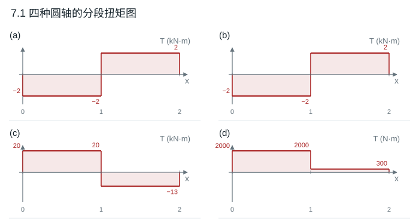

# 第 7 章 圆轴扭转

教材第 120–121 页。圆轴用 $J=\pi(D^4-d^4)/32$、$\tau_{\max}=|T|D/(2J)$、$\theta=T/(GJ)$，功率关系 $P=2\pi nT/60$。

## 7.1 四种扭矩图

从左至右逐段切开，内扭矩取截面右侧外力偶的代数和。各图正方向分别取 (a)、(b) 的右端 2 kN·m、(c) 的中间 33 kN·m、(d) 的 1700 N·m 所指方向。

| 子图 | 左段 | 右段 | 单位 |
|---|---:|---:|---|
| a | $2-4=-2$ | $+2$ | kN·m |
| b | $2-4=-2$ | $+2$ | kN·m |
| c | $33-13=+20$ | $-13$ | kN·m |
| d | $1700+300=+2000$ | $+300$ | N·m |

**结果**　扭矩图由各段常值和集中力偶处的跳变构成，横坐标按段编号示意。空心或实心不影响本题由平衡求出的扭矩。

## 7.2 实心圆轴最大切应力

7.1(c) 的最大扭矩绝对值为 20 kN·m，危险截面在左段。$d=0.12$ m，实心轴抗扭截面系数 $W_t=\pi d^3/16$。

**结果**　$\tau_{\max}=20\,000/W_t=58.95$ MPa。

## 7.3 内孔变化的传动轴

各段均传递 $1600$ N·m，外径 50 mm 不变。分别用内径 25 mm、38 mm 求极惯性矩。

**结果**　两段外缘最大切应力分别为 69.54 MPa、97.83 MPa，危险段为内孔 38 mm 的一段。

## 7.4 实心阶梯轴

取图中各外力偶共同的方向为正。由右侧力偶求得自左向右各段扭矩 $1400,700,200,0$ N·m。对应直径 $60,50,35,30$ mm，长度 $200,300,300,150$ mm。用 $\tau_{\max}=16T/(\pi d^3)$ 得各段 $33.01,28.52,23.76,0$ MPa。

**结果**　最大切应力 33.01 MPa。右端相对固定端扭转角 $\sum T_i L_i/(GJ_i)=0.01385$ rad，即 $0.794^\circ$，与所取正方向相同。

## 7.5 两个转速的传动功率

$d=0.020$ m，$T_{\rm lim}=[\tau]\pi d^3/16=109.96$ N·m。

**结果**　在 200、500 r/min 时分别可传递 2.303、5.757 kW。

## 7.6 大型空心轴最小壁厚

额定扭矩 $T=7\times10^6(60)/(2\pi120)=5.5704\times10^5$ N·m。外半径 $0.175$ m。强度要求 $J\ge TD/(2[\tau])=7.799\times10^{-4}$ m⁴；刚度要求 $J\ge T/(G[\theta])\approx4.560\times10^{-4}$ m⁴，其中 $[\theta]=\pi/180$ rad/m。

**结果**　强度控制。令 $\pi(D^4-d^4)/32=7.799\times10^{-4}$ m⁴，得到 $d\approx289.90$ mm、$t_{\min}\approx30.05$ mm。

## 7.7 发动机和变速箱输出轴

$T=P(60)/(2\pi n)=420.17$ N·m。按实心轴强度，$d_{\min}=[16T/(\pi[\tau])]^{1/3}$。变速比 $2:1$ 按转速减半、忽略功率损失处理，输出扭矩加倍。

**结果**　发动机轴 $d_{\min}=31.27$ mm，变速箱输出轴 $d_{\min}=39.40$ mm。

## 7.8 转两周的铁丝

相对转角 $\varphi=4\pi$ rad。线弹性扭转中 $\gamma_{\max}=(d/2)\varphi/l$，$\tau_{\max}=G\gamma_{\max}$。

**结果**　$\tau_{\max}=70\times10^9(0.0005)(4\pi)/10=43.98$ MPa。

## 7.9 强度、刚度和重量的比较

设内外径比 $\alpha$。强度给出 $D_\tau=[16M/(\pi[\tau](1-\alpha^4))]^{1/3}$；刚度给出 $D_\theta=[32M/(\pi G[\theta](1-\alpha^4))]^{1/4}$。$[\theta]=0.25\pi/180$ rad/m。

| 截面 | 强度下限 | 刚度下限 | 采用的最小外径 |
|---|---:|---:|---:|
| 实心 | 46.70 mm | 73.50 mm | 73.50 mm |
| 空心，$\alpha=0.8$ | 55.67 mm | 83.85 mm | 83.85 mm |

**结果**　两者都由刚度控制。同材、同长度下，空心与实心重量之比 $0.36(83.85/73.50)^2\approx0.469$。

## 7.10 两端固定轴的中间力偶

令 $M$ 为正，左右固定端反力偶均与之相反。$C$ 两侧相当于并联的转动弹簧，刚度分别为 $GJ/L_{AC}$ 和 $GJ/L_{CB}$。反力偶大小按刚度分配。

**结果**　$M_A=-1500(700/1700)=-617.65$ N·m，$M_B=-1500(1000/1700)=-882.35$ N·m。$C$ 相对两固定端的转角为 $617.65(1.0)/(GJ)=0.01549$ rad，约 $0.887^\circ$，沿 $M$ 方向。
