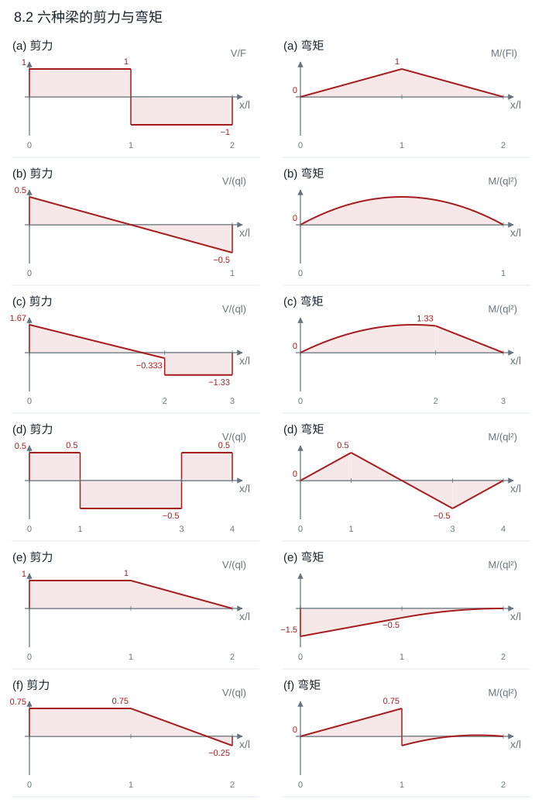
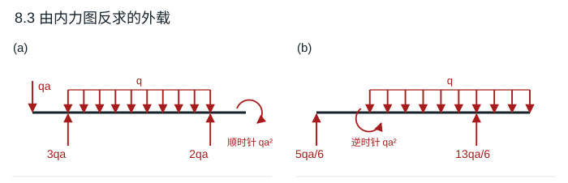
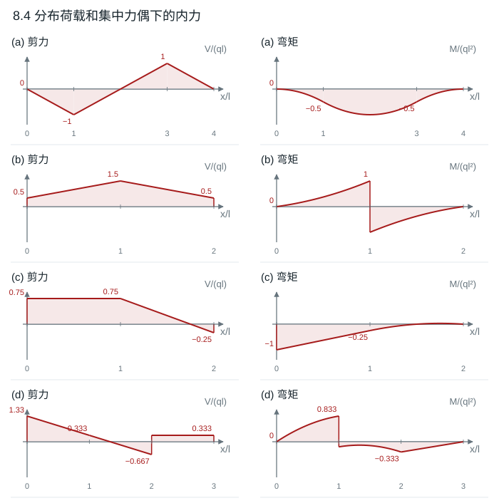
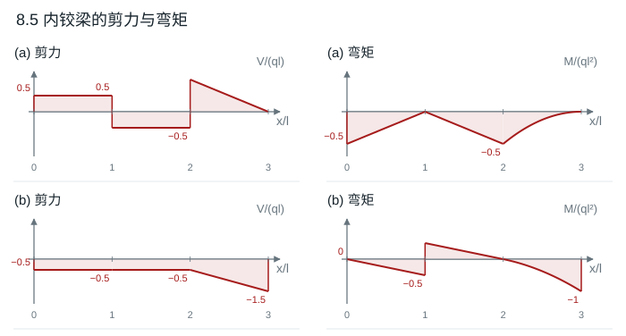

# 第 8 章 梁的弯曲内力

教材第 133–135 页。$x$ 自梁左端向右，$V$ 为左侧外力竖向代数和，$M$ 下缘受拉为正。向下分布荷载 $q$ 对应 $V'=-q$、$M'=V$；逆时针外力偶 $C$ 使弯矩跃变 $-C$。$\langle u\rangle^n$ 在 $u>0$ 时等于 $u^n$，在 $u<0$ 时为零，$H(u)=\langle u\rangle^0$。

## 8.1 指定截面的剪力和弯矩

由各梁整体平衡求反力，依次从左向右写截面量。下面给出整跨表达式，细线位于荷载处时取相应的单侧极限。

| 子图 | 剪力 $V(x)$ | 弯矩 $M(x)$ |
|---|---|---|
| a | $F$，$0<x<2l$ | $Fx$；$A^+,C,B^-$ 分别为 $0,Fl,2Fl$ |
| b | $M_e/(2l)$ | $M_e(x/(2l)-1)$；$A^+,C,B^-$ 分别为 $-M_e,-M_e/2,0$ |
| c | $ql[H(x-l)-H(x-2l)]$ | $-ql^2+ql\langle x-l\rangle-ql\langle x-2l\rangle$；在 $A,C,D,B$ 分别为 $-ql^2,-ql^2,0,0$ |
| d | $2ql-2qlH(x-l)-q\langle x-l\rangle$ | $2qlx-2ql\langle x-l\rangle-q\langle x-l\rangle^2/2$；在 $A,B,C$ 分别为 $0,2ql^2,0$ |

**结果**　(c) 的 $V$ 在 $C,D$ 分别跳 $+ql,-ql$；(d) 的 $V(B^-,B^+,C^-)$ 为 $2ql,0,-2ql$。这些跳变来自集中力或支反力。

## 8.2 六根梁的剪力和弯矩图

用 $t=x/l$。表中 (a) 的剪力、弯矩分别用 $F,Fl$ 归一化，其余用 $ql,ql^2$ 归一化。支座反力由 $\sum F_y=\sum M_A=0$ 求出，再从左端积分 $M'=V$，按力偶作跳变。

| 子图 | 主要反力（竖向向上为正） | 归一化 $V$ | 归一化 $M$ |
|---|---|---|---|
| a | $A_y=F,C_y=-2F$ | $1-2H(t-1)$ | $t-2\langle t-1\rangle$ |
| b | $B_y=ql/2$，固定端力偶零 | $1/2-t$ | $t/2-t^2/2$ |
| c | $A_y=5ql/3,B_y=4ql/3$ | $5/3-t+\langle t-2\rangle-H(t-2)$ | $5t/3-t^2/2+\langle t-2\rangle^2/2-\langle t-2\rangle$ |
| d | $A_y=ql/2,B_y=-ql/2$ | $1/2-H(t-1)+H(t-3)$ | $t/2-\langle t-1\rangle+\langle t-3\rangle$ |
| e | $A_y=ql,M_A^{\rm 支}=3ql^2/2$ | $1-\langle t-1\rangle$ | $-3/2+t-\langle t-1\rangle^2/2$ |
| f | $A_y=3ql/4,B_y=ql/4$ | $3/4-\langle t-1\rangle$ | $3t/4-H(t-1)-\langle t-1\rangle^2/2$ |

**结果**　(f) 的 $M(1^-)=3/4$、$M(1^+)=-1/4$，剪力连续；(c) 的集中荷载只使剪力跳变。负滚动反力为代数结果，实际单面支承需防脱。

## 8.3 从内力图反推外力

剪力斜率给出分布荷载，剪力的跳量给出集中力，弯矩跳量的相反数给出外力偶。

| 子图 | 向上的集中力（向下写负值） | 分布力 | 外力偶 |
|---|---|---|---|
| a | $x=0:-qa$；$x=a:+3qa$；$x=5a:+2qa$ | $a<x<5a$ 向下 $q$ | 右端 $x=6a$ 顺时针 $qa^2$ |
| b | $x=0:+5qa/6$；$x=3a:+13qa/6$ | $a<x<4a$ 向下 $q$ | $x=a$ 逆时针 $qa^2$ |

**结果**　(a) $V$ 在 $5a$ 后为零，$M=-qa^2$ 保持到端部。(b) 在 $a$ 处 $M$ 从 $5qa^2/6$ 跳到 $-qa^2/6$，与上表相符。

## 8.4 利用分布荷载与内力的关系

令 $t=x/l$，表中 $V,M$ 的单位分别为 $ql,ql^2$。分布荷载换成总力求支反力，再按 $V'=-q(x)$、$M'=V$ 分段积分。

| 子图 | $A_y,B_y$（以 $ql$ 为单位） | $V/(ql)$ | $M/(ql^2)$ |
|---|---|---|---|
| a | $0,0$ | $-t+2\langle t-1\rangle-2\langle t-3\rangle$ | $-t^2/2+\langle t-1\rangle^2-\langle t-3\rangle^2$ |
| b | $1/2,-1/2$ | $1/2+t-2\langle t-1\rangle$ | $t/2+t^2/2-\langle t-1\rangle^2-2H(t-1)$ |
| c | $3/4,1/4$ | $3/4-\langle t-1\rangle$ | $-1+3t/4-\langle t-1\rangle^2/2$ |
| d | $4/3,-1/3$ | $4/3-t+H(t-2)+\langle t-2\rangle$ | $4t/3-t^2/2-H(t-1)+\langle t-2\rangle+\langle t-2\rangle^2/2$ |

**结果**　(a) $M_{\min}=-ql^2$ 在跨中；(b) $M(l^\pm)=+ql^2,-ql^2$；(c) 左端内弯矩 $-ql^2$；(d) 在 $l$ 处弯矩下降 $ql^2$，在 $2l$ 处剪力上跳 $ql$。

## 8.5 两根带内铰的梁

令 $t=x/l$，$V,M$ 以 $ql,ql^2$ 归一化。在铰 $B$ 或 $C$ 处 $M=0$，分开取左右自由体。

(a) 右部对 $B$ 取矩，得 $C_y=3ql/2$；右部铰力为 $-ql/2$。给定的 $ql$ 集中力归到左部时，左部 $B$ 端合力为 $-ql/2$。

| 区间 | $V$ | $M$ |
|---|---|---|
| $0<t<1$ | $1/2$ | $(t-1)/2$ |
| $1<t<2$ | $-1/2$ | $-(t-1)/2$ |
| $2<t<3$ | $1-(t-2)$ | $-1/2+(t-2)-(t-2)^2/2$ |

(b) 左部关于 $A$ 的平衡给出铰力向上 $ql/2$、$A_y=-ql/2$。右部受反向铰力和均布荷载，故 $D_y=3ql/2$、固定端力偶顺时针 $ql^2$。

| 区间 | $V$ | $M$ |
|---|---|---|
| $0<t<1$ | $-1/2$ | $-t/2$ |
| $1<t<2$ | $-1/2$ | $1-t/2$ |
| $2<t<3$ | $-1/2-(t-2)$ | $-(t-2)/2-(t-2)^2/2$ |

**结果**　(a) $M(A)=-ql^2/2$、$M(C)=-ql^2/2$；(b) $M(B^-)=-ql^2/2$、$M(B^+)=+ql^2/2$，$M(D^-)=-ql^2$。

## 8.6 等长外伸段的最佳长度

对称性给出两个反力均为 $ql/2$。支座的负弯矩为 $-qa^2/2$，跨中剪力为零且 $M_{\rm mid}=ql^2/8-qla/2$。在最优点，支座负弯矩绝对值等于跨中正弯矩。

**结果**　$qa^2/2=ql^2/8-qla/2$，所以 $a=(\sqrt2-1)l/2\approx0.2071l$。此时最大弯矩绝对值为 $(3-2\sqrt2)ql^2/8$。
