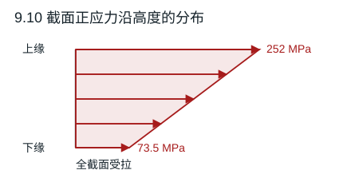

# 第 9 章 梁的弯曲应力与弯曲强度

教材第 153–157 页。令 $M>0$ 表示下缘受拉。非对称截面分别使用上、下缘截面系数 $I/c$。型钢数据取教材附录 D 的工字钢表。

## 9.1 四种截面的形心轴惯性矩

组合截面先按 $\bar y=\sum A_i y_i/\sum A_i$ 求形心，再用 $I_z=\sum[b_i h_i^3/12+A_i(y_i-\bar y)^2]$。矩形孔用负面积。

| 子图 | 拆分及形心位置 | $I_z$（mm⁴） |
|---|---|---:|
| a | 外矩形 $150\times250$ 减同心孔 $100\times200$ | $1.28646\times10^8$ |
| b | $450\times100$ 翼缘与 $250\times500$ 腹板，形心距顶 270.588 mm | $5.61961\times10^9$ |
| c | $50\times200$ 竖肢与 $150\times50$ 底肢，形心距底 96.429 mm | $1.01860\times10^8$ |
| d | $150\times30$、$30\times200$、$200\times30$ 三部分，形心距顶 140.455 mm | $1.57847\times10^8$ |

**结果**　表中各惯性矩均对各自的水平形心轴，腹板与翼缘的重叠区域只计一次。

## 9.2 钢条一端被提起

设提力 $P=F/4$，每单位长度自重 $q=F/l$，从提起端向接触区量距离 $s$。悬起段的弯矩为 $Ps-qs^2/2$。钢条与刚性平面分离处弯矩为零，所以悬起长度 $2P/q=l/2$。$V=0$ 在 $s=P/q=l/4$。

**结果**　$M_{\max}=P^2/(2q)=Fl/32$，$W=\pi D^3/32$，因此 $|\sigma|_{\max}=Fl/(\pi D^3)$。

## 9.3 铸铁倒 T 形梁的翼板宽度

题图力偶使下缘拉、上缘压。令两边缘同时达到许用应力的比例 $y_1:y_2=1:3$，且 $y_1+y_2=500$ mm，得形心距底 $y_1=125$ mm。翼板面积 $80b$、形心距底 40 mm，腹板面积 $40(420)$、形心距底 290 mm。

**结果**　$125(80b+16800)=40(80b)+290(16800)$，解得 $b=407.65$ mm。

## 9.4 移动集中荷载下的 T 形外伸梁

截面由 $100\times20$ 与 $20\times80$ 两部分组成，形心距顶 $c_t=32.222$ mm、距底 $c_b=67.778$ mm，$I=3.14222\times10^6$ mm⁴。当力位于 $AB$ 中点时正弯矩包络最大，为 $Fl/4$；移到 $C$ 时 $B$ 处负弯矩绝对值最大，为 $Fl/2$。

对正弯矩按下拉、上压核算；负弯矩按上拉、下压核算。取 $l=1500$ mm，得到四个载荷上限 $4.945,39.007,5.201,9.272$ kN。

**结果**　$[F]=4.95$ kN，由 $AB$ 跨中下缘拉应力控制。

## 9.5 矩形外伸木梁的强度

整体反力 $A_y=1.5$ kN、$B_y=4.5$ kN。左跨 $V=1.5-2x$（kN），$M=1.5x-x^2$（kN·m）。$x=0.75$ m 正峰为 0.5625 kN·m，$B$ 处负弯矩为 $-1$ kN·m，$|V|_{\max}=2.5$ kN。

**结果**　$\sigma_{\max}=10^6/(50\cdot100^2/6)=12$ MPa；$\tau_{\max}=3(2500)/(2\cdot50\cdot100)=0.75$ MPa。分别低于 15 MPa 和 2 MPa。

## 9.6 固定端截面的四点应力

右端逆时针力偶抵消集中力的一部分弯矩，固定端截面 $M=25-10(2)=5$ kN·m。矩形 $I=120(200)^3/12=8.0\times10^7$ mm⁴。取 $y$ 向下，$a,b,c,d$ 的 $y$ 分别为 $-100,0,50,100$ mm。

**结果**　由 $\sigma=My/I$ 得 $(\sigma_a,\sigma_b,\sigma_c,\sigma_d)=(-6.25,0,3.125,6.25)$ MPa。

## 9.7 悬臂木梁上的横向孔

把图中 $q$ 按载荷集度 2.5 kN/m 使用。固定端 $|M_A|=4(1.2)+2.5(1.2)^2/2=6.60$ kN·m，完整截面边缘应力 8.25 MPa。过孔中心的横截面减去中部高度为 $d$ 的通孔带，$I_{\rm net}=120(200^3-d^3)/12$ mm⁴。该处 $|M|=4(0.9)+2.5(0.9)^2/2=4.6125$ kN·m。

**结果**　按孔心净截面 $\sigma=|M|(100)/I_{\rm net}\le10$ MPa 得 $d\le150.18$ mm。若沿孔宽再逐截面检查名义应力，用 $h_{\rm hole}(x)=\sqrt{d^2-4(x-300)^2}$ 替代 $d$，在孔内找最大值，得到约 150.02 mm。工程取整为 150 mm。本题按梁理论的名义应力，未计孔缘局部应力集中。

## 9.8 固定端 T 形截面的拉、压应力

竖向 $F$ 与图示力偶对右端截面产生同向弯曲，内弯矩为 $-(Fl+M_e)=-15$ kN·m。两块面积均为 $3750$ mm²，距顶各为 12.5 mm 与 100 mm，故形心距顶 56.25 mm、距底 118.75 mm。平行轴定理给出 $I=2.15820\times10^7$ mm⁴。

**结果**　上缘最大拉应力 39.10 MPa，下缘最大压应力的大小 82.53 MPa。

## 9.9 双向受力悬臂的截面尺寸

两个正交弯矩大小分别为 $F_2l=1.6$ kN·m、$F_1(2l)=1.6$ kN·m。矩形 $h=2b$ 时，最危险角点两项相加，截面系数分别 $2b^3/3,b^3/3$。圆截面用合弯矩 $1.6\sqrt2$ kN·m。

**结果**　矩形 $b\ge(7.2\times10^6/160)^{1/3}=35.57$ mm、$h\ge71.14$ mm；圆形 $d\ge[32(1.6\sqrt2\times10^6)/(\pi160)]^{1/3}=52.42$ mm。

## 9.10 偏心拉伸的反问题

表面应力为 $210000(1.2\times10^{-3})=252$ MPa、$210000(0.35\times10^{-3})=73.5$ MPa。应力沿高 30 mm 线性分布，平均值 162.75 MPa，弯曲分量幅值 89.25 MPa。$A=180$ mm²、$W=900$ mm³。

**结果**　$F=162.75(180)=29.295$ kN；$M=89.25(900)=80325$ N·mm，偏心距 $e=M/F=2.742$ mm，在形心上方。

## 9.11 中点应变推算全梁最大应力

逆时针端力偶 $ql^2/4$ 使 $A_y=3ql/4$。$M(x)=3qlx/4-qx^2/2$，零剪力点 $x=3l/4$，$M_{\max}=9ql^2/32$。跨中 $M_C=ql^2/4$，故应力放大比 $9/8$，不必单独求 $q$。

**结果**　$\sigma_C=E\varepsilon=50$ MPa，$\sigma_{\max}=56.25$ MPa。

## 9.12 外伸工字梁选型

末端 $F$ 向上。整体平衡 $A_y+B_y=60-24=36$ kN、$3B_y=60(2)-24(4)$，故 $A_y=28$ kN、$B_y=8$ kN。$AB$ 跨内 $M=28x-7.5x^2$，正峰 $28^2/30=26.133$ kN·m。$BC$ 从 $M_B=16.5$ kN·m 递减到零。

**结果**　$W_{\min}=26.133\times10^6/160=163.33$ cm³。附录 16 号的 141 cm³ 不足，18 号的 185 cm³ 满足，选 **18 号工字钢**。

## 9.13 简支工字梁的弯剪选型

支反力均为 $(10\cdot8+30)/2=55$ kN，跨中 $M_{\max}=10(8)^2/8+30(8)/4=140$ kN·m。要求 $W\ge823.53$ cm³。附录 32c 的 760.47 cm³ 不足，36a 的 875 cm³ 满足。36a 腹板厚 10 mm，$I/S=30.7$ cm。

**结果**　选 **36a 工字钢**，$\sigma_{\max}=160$ MPa，$\tau_{\max}=55000/[10(307)]=17.92$ MPa，满足 170 MPa 和 100 MPa 的限制。

## 9.14 非对称铸铁截面的双向弯矩校核

按图将端力偶量纲取为 10 kN·m（逆时针）。支座反力 $B_y=33.333$ kN、$D_y=6.667$ kN。左外伸端至 $B$ 的负峰为 $M_B=-20(0.5)^2/2=-2.5$ kN·m。$BD$ 在距 $A$ 1.667 m 处 $V=0$，正峰为 11.111 kN·m。

**结果**　两种弯矩符号分别检查边缘。最大拉应力为 $11.111\times10^3(0.05)/I=38.29$ MPa；最大压应力的大小为 $11.111\times10^3(0.10)/I=76.58$ MPa。均满足许用值。

## 9.15 胶合木梁所需层数

对称两荷载各 15 kN，支座各 15 kN。$M_{\max}=30$ kN·m，$|V|_{\max}=15$ kN。设 $n$ 层，$b=100$ mm、$h=30n$ mm。偶数层的中性轴恰为胶缝，故该胶缝有矩形截面最大剪应力。

$$
\sigma_{\max}=\frac{6M_{\max}}{bh^2}=\frac{2000}{n^2}\ \mathrm{MPa},\qquad
\tau_{\max}=\frac{3V_{\max}}{2bh}=\frac{7.5}{n}\ \mathrm{MPa}.
$$

**结果**　弯曲要求 $n\ge11.55$，胶缝要求 $n\ge16.67$，最小偶数层数为 **18**。

## 9.16 边缘切口允许深度

切口截面的净高 $h=50-x$，净截面形心偏移 $e=x/2$。用 $\sigma_{\max}=F/(6h)+Fe/(h^2)$（净截面 $W=6h^2/6$），令其等于 120 MPa，整理得 $120x^2-17000x+175000=0$。

**结果**　取满足 $0<x<50$ mm 的根，$x_{\max}=11.18$ mm。

## 9.17 等面积实心和空心圆梁

均布载荷产生 $M_{\max}=2(4)^2/8=4$ kN·m。设 $k=d_2/D_2=0.4$，等面积给出 $D_2=80/\sqrt{1-k^2}=87.29$ mm。实心截面系数 $\pi D_1^3/32$，空心截面系数 $\pi D_2^3(1-k^4)/32$。

**结果**　实心最大应力 79.58 MPa，空心 62.87 MPa，降低 $1-\sqrt{1-k^2}/(1+k^2)=20.99\%$。
