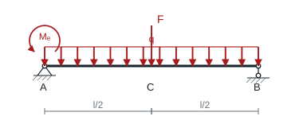
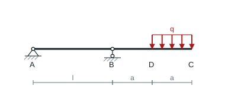
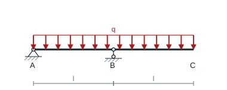
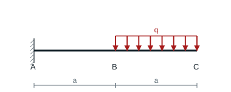
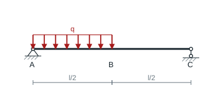
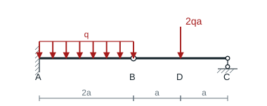
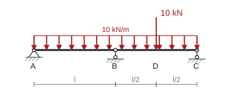

# 第 10 章 梁的弯曲变形与刚度

教材第 172–174 页。挠度向上、转角逆时针为正，采用 $EIw''=M$。$\langle z\rangle^n$ 在 $z>0$ 时等于 $z^n$，在 $z<0$ 时为零。

## 10.1 端力偶与对称荷载叠加

### 题目

**题意**　用积分法分析集中力、均布力和端力偶共同作用的简支梁。

**已知条件**　$AB=l$，$C$ 为跨中，梁的弯曲刚度 $EI$；全跨向下均布 $q$，$C$ 受向下的 $F$，$A$ 有逆时针力偶 $M_e$。两端支座处挠度为零。

**求解要求**　求 $C$ 的挠度、$B$ 的转角和最大转角，判断最大下挠在哪一半跨。

### 解答

设图示逆时针端力偶为 $M_e$。整体平衡得到 $R_A=ql/2+F/2+M_e/l$。由弯矩 $M=R_Ax-qx^2/2-F\langle x-l/2\rangle-M_e$ 两次积分，并令 $w(0)=w(l)=0$：

$$
EIw=R_Ax^3/6-qx^4/24-F\langle x-l/2\rangle^3/6-M_ex^2/2+C_1x,\quad
C_1=-ql^3/24-Fl^2/16+M_el/3.
$$

**结果**　$EIw_C=-5ql^4/384-Fl^3/48+M_el^2/16$，$EI\theta_B=ql^3/24+Fl^2/16-M_el/6$。最大转角的绝对值取 $\theta(0),\theta(l)$ 及区间内 $M(x)=0$ 处 $\theta(x)$ 的最大绝对值，其中 $\theta=w'$。

计算内部候选点时，在 $AC$ 求解 $R_Ax-qx^2/2-M_e=0$；在 $CB$ 利用 $M=(l-x)[R_B-q(l-x)/2]$，仅保留属于相应开区间的根。将这些根代入 $EI\theta=R_Ax^2/2-qx^3/6-F\langle x-l/2\rangle^2/2-M_ex+C_1$ 即可直接比较。

若 $M_e>0$，比较镜像截面 $x$ 与 $l-x$：向下荷载造成的挠度相同，而力偶项 $M_e x(l-x)(2l-x)/(6lEI)$ 在左半段更大。故若存在向下的挠度极值，它在 $CB$ 段；向上的极值在 $AC$ 段。若所问是最大**绝对值**，应求 $w'(x)=0$ 后比较正负极值，不能在未给出 $q,F,M_e$ 比例时指定唯一一段。$M_e=0$ 时对称，最大下挠在 $C$。

## 10.2 末段均布荷载的外伸梁

### 题目

**题意**　外伸梁只在靠近自由端的一段受均布载荷。

**已知条件**　从左到右 $A,B,D,C$，$A,B$ 简支，$AB=l$、$BD=DC=a$；仅 $DC$ 向下均布 $q$，弯曲刚度 $EI$。

**求解要求**　用积分法求 $C$ 的挠度和转角。

### 解答

$B$ 距 $A$ 为 $l$，末段 $DC$ 长 $a$。整体平衡给出 $R_A=-3qa^2/(2l),R_B=qa-R_A$。由积分及 $w(0)=w(l)=0$：

$$
EIw=R_Ax^3/6+R_B\langle x-l\rangle^3/6-q\langle x-l-a\rangle^4/24-R_Al^2x/6.
$$

**结果**　代入 $x=l+2a$，$\theta_C=-(qa^2l/2+7qa^3/6)/(EI)$，$w_C=-(qa^3l+41qa^4/24)/(EI)$。

## 10.3 全长均布载荷的外伸梁

### 题目

**题意**　全长均布载荷作用在一根外伸梁上。

**已知条件**　$A,B$ 简支，$AB=BC=l$，$C$ 自由。全长向下均布 $q$，弯曲刚度 $EI$。

**求解要求**　用叠加法求 $C$ 的挠度和转角。

### 解答

总长 $2l$，$R_A=0,R_B=2ql$。左跨 $M=-qx^2/2$，由 $w(0)=w(l)=0$ 得 $\theta_B=-ql^3/(8EI)$。右外伸段叠加 $B$ 处刚体转动和长 $l$ 悬臂受均布载荷的相对变形。

**结果**　$\theta_C=\theta_B-ql^3/(6EI)=-7ql^3/(24EI)$；$w_C=l\theta_B-ql^4/(8EI)=-ql^4/(4EI)$。

## 10.4 悬臂后半段均布荷载

### 题目

**题意**　悬臂梁只有自由端一半受均布载荷。

**已知条件**　$A$ 固定，$AB=BC=a$，仅 $BC$ 向下均布 $q$，弯曲刚度 $EI$。

**求解要求**　用叠加法求 $C$ 的挠度和转角。

### 解答

在 $a\le s\le2a$ 处取小荷载 $q\,ds$。由长 $s$ 的悬臂端力解，再加从 $s$ 到 $2a$ 的刚体延伸，端转角和端挠度的增量为

$$
d\theta_C=-qs^2\,ds/(2EI),\qquad
dw_C=-qs^2(6a-s)\,ds/(6EI).
$$

**结果**　在 $[a,2a]$ 积分，$\theta_C=-7qa^3/(6EI)$，$w_C=-41qa^4/(24EI)$。

## 10.5 简支梁左半跨受均布荷载

### 题目

**题意**　仅在简支梁的左半跨施加均布载荷。

**已知条件**　两端 $A,C$ 简支，跨度 $l$，$B$ 为中点。$AB$ 受向下均布 $q$，$BC$ 无载，弯曲刚度 $EI$。

**求解要求**　求 $B$ 的挠度。

### 解答

左、右两种半跨均布载荷在跨中 $B$ 的挠度相同，叠加后成为全跨均布载荷。全跨均布跨中挠度由 $EIw''=qlx/2-qx^2/2$ 及两支座零位移积分得到 $-5ql^4/(384EI)$。

**结果**　左半跨载荷所致 $w_B=-5ql^4/(768EI)$。

## 10.6 内铰梁的 B 和 D 挠度

### 题目

**题意**　左悬臂和右简支段通过内铰传力，内铰本身可以沉降。

**已知条件**　$A$ 固定，$B$ 为内铰，$C$ 为竖向活动支承。$AB=2a$，$BD=DC=a$；$AB$ 向下均布 $q$，$D$ 受向下的 $2qa$，两段弯曲刚度 $EI$。

**求解要求**　求 $B,D$ 的竖向挠度。

### 解答

右跨 $BC=2a$，中点 $D$ 承受 $2qa$，铰 $B$、支座 $C$ 的支反力各为 $qa$。故左悬臂 $AB=2a$ 同时承受均布载荷和端部向下 $qa$。

$$
w_B=-\frac{q(2a)^4}{8EI}-\frac{qa(2a)^3}{3EI}=-\frac{14qa^4}{3EI}.
$$

**结果**　右跨中点相对支承连线的挠度 $-(2qa)(2a)^3/(48EI)=-qa^4/(3EI)$。再加 $B,C$ 沉降的平均值，$w_D=w_B/2-qa^4/(3EI)=-8qa^4/(3EI)$。

## 10.7 两跨连续梁的正应力校核

### 题目

**题意**　校核一根三支座的等截面连续梁。

**已知条件**　$A$ 固定铰，$B,C$ 为竖向活动支承，两跨 $AB=BC=2$ m；全长向下均布 10 kN/m，右跨中点 $D$ 受向下 10 kN。实心圆截面直径 100 mm，许用应力 100 MPa。

**求解要求**　求最大弯曲正应力，判断是否满足强度。

### 解答

两跨均长 $l=2$ m。用三弯矩方程，简支基本体系每跨均布荷载弯矩图面积 $ql^3/12$，右跨中点力额外面积 $Fl^2/8$，各面积形心均位于跨中。

$$
4lM_B=-3(2ql^3/12+Fl^2/8),\qquad M_B=-ql^2/8-3Fl/32=-6.875\ \mathrm{kN\cdot m}.
$$

两端反力分别 $6.5625,11.5625$ kN。左跨正峰为 $R_A^2/(2q)=2.153$ kN·m。右跨在 $D$ 处剪力由正变负，$M_D=6.5625$ kN·m，故危险截面为 $B$。

**结果**　$\sigma_{\max}=6.875\times10^6/(\pi100^3/32)=70.03$ MPa，小于 100 MPa，满足弯曲正应力强度条件。
