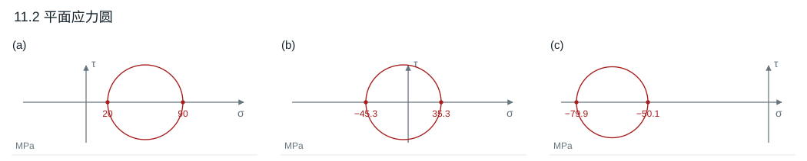
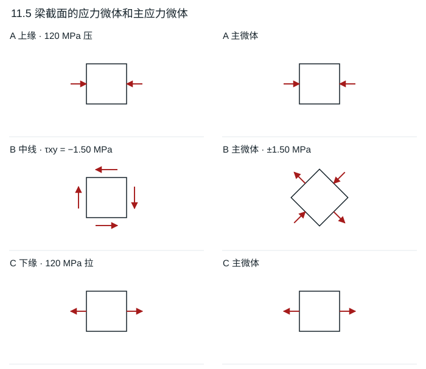
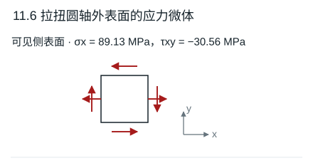

# 第 11 章 应力状态分析

教材第 185–186 页。$x$ 向右、$y$ 向上，$\tau_{xy}>0$ 表示在 $+x$ 面指向 $+y$。斜面的单位法线 $\boldsymbol n=(\cos\alpha,\sin\alpha)$，切向取 $\boldsymbol t=(-\sin\alpha,\cos\alpha)$。切应力换用相反的切向定义时符号相反。

## 11.1 三种平面应力的斜面分量

设 $c=(\sigma_x+\sigma_y)/2,d=(\sigma_x-\sigma_y)/2$。用 $\sigma_n=c+d\cos2\alpha+\tau_{xy}\sin2\alpha$、$\tau_{nt}=-d\sin2\alpha+\tau_{xy}\cos2\alpha$。

| 子图 | $(\sigma_x,\sigma_y,\tau_{xy})$ MPa | 法线角 $\alpha$ | $\sigma_n$ MPa | $\tau_{nt}$ MPa |
|---|---|---:|---:|---:|
| a | $(90,20,0)$ | $30^\circ$ | 72.50 | −30.31 |
| b | $(-40,30,-20)$ | $-45^\circ$ | 15.00 | −35.00 |
| c | $(-60,-70,14)$ | $-15^\circ$ | −67.67 | 14.62 |

**结果**　正号表示拉应力。表中 $\alpha$ 是斜面**法线**角，从题图的斜面方向转过 $90^\circ$ 得到。

## 11.2 主应力及应力圆

圆心 $(c,0)$，半径 $R=\sqrt{d^2+\tau_{xy}^2}$，主应力 $c\pm R$。较大平面主应力方向由 $2\alpha_1=\operatorname{atan2}(\tau_{xy},d)$ 求得。

| 子图 | $c$ MPa | $R$ MPa | 平面主应力 MPa | 较大主应力方向 |
|---|---:|---:|---|---:|
| a | 55 | 35 | 90、20 | $0^\circ$ |
| b | −5 | 40.311 | 35.311、−45.311 | $-75.13^\circ$ |
| c | −65 | 14.866 | −50.134、−79.866 | $35.17^\circ$ |

**结果**　垂直板面还存在一个零主应力。若要求 $\sigma_1\ge\sigma_2\ge\sigma_3$，应将零一起排序。

## 11.3 平面应力下的三向最大切应力

主应力为 $2\sigma,\sigma,0$。应力圆三对主应力中，最大直径由 $2\sigma$ 和 $0$ 构成。

**结果**　$\tau_{\max}=\sigma$（按题图 $\sigma>0$）。最大切应力面法线在 $xz$ 平面内，与 $x$、$z$ 主轴各成 $45^\circ$；该面上的剪应力方向也在 $xz$ 平面内。

## 11.4 用两片应变计反求应力

$A$ 片沿 $x$，$B$ 片沿 $y$。平面应力的广义胡克定律给出

$$
\sigma_x=\frac{E(\varepsilon_A+\mu\varepsilon_B)}{1-\mu^2},\qquad
\sigma_y=\frac{E(\varepsilon_B+\mu\varepsilon_A)}{1-\mu^2}.
$$

**结果**　按图文所给的两个负应变，$\sigma_x=-36.92$ MPa、$\sigma_y=-53.08$ MPa，均为压应力。这与题干描述的双向拉力矛盾，若应变符号改为正，两个结果也同时改为正。

## 11.5 梁同一截面的上缘、中线和下缘

集中力在跨中，故两端竖向反力各 5 kN。所求截面距左端 2 m，$M=10$ kN·m、$V=5$ kN。矩形 $50\times100$ mm，$W=50(100)^2/6$ mm³，$A=5000$ mm²。

| 点 | $(\sigma_x,\sigma_y,\tau_{xy})$ MPa | 平面主应力与方向 |
|---|---|---|
| A，上缘 | $(-120,0,0)$ | $x$ 向压 120，$y$ 向零 |
| B，中线 | $(0,0,-1.50)$ | $-45^\circ$ 方向拉 1.50，$+45^\circ$ 方向压 1.50 |
| C，下缘 | $(120,0,0)$ | $x$ 向拉 120，$y$ 向零 |

**结果**　上下自由边无切应力；中线处 $|\tau|=3V/(2A)=1.50$ MPa，主微体相对原微体转 $45^\circ$。

## 11.6 拉扭圆轴表面斜向应变

令 $x$ 沿轴向右、$y$ 沿表面切线的图示向上方向。轴拉 $\sigma_x=4F/(\pi d^2)=89.13$ MPa，$\sigma_y=0$，扭剪大小 $16M/(\pi d^3)=30.56$ MPa。按图右端力偶和可见表面位置，$+x$ 面切应力向下，$\tau_{xy}=-30.56$ MPa。微体上两对剪应力互等，$+y$ 面指向 $-x$。

$$
\varepsilon_{45^\circ}=\frac{\sigma_x(1-\mu)}{2E}+\frac{\tau_{xy}}{2G},
\qquad G=E/[2(1+\mu)].
$$

**结果**　图示方向 $\varepsilon_{45^\circ}\approx-42.7\times10^{-6}$。若取另一条 $-45^\circ$ 对角线，扭转项反号，应变约 $354.6\times10^{-6}$。

