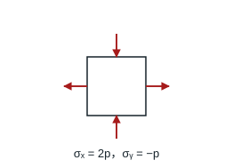
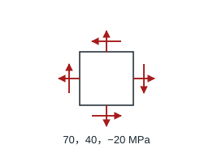
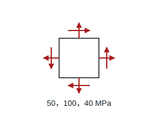
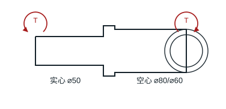
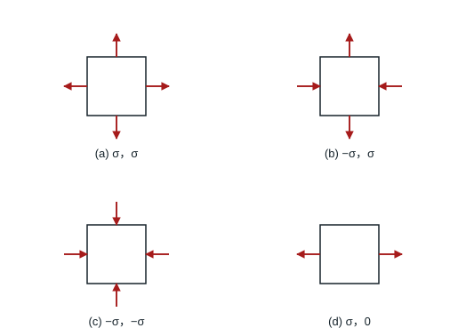
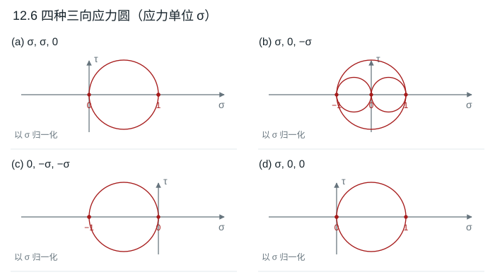
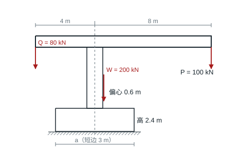
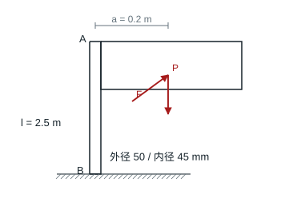

# 第 12 章 复杂应力状态的强度

教材第 202–204 页。主应力按 $\sigma_1\ge\sigma_2\ge\sigma_3$ 排列。第三理论用 $\sigma_1-\sigma_3$，第四理论用 $\sqrt{[(\sigma_1-\sigma_2)^2+(\sigma_2-\sigma_3)^2+(\sigma_3-\sigma_1)^2]/2}$。

## 12.1 脆性材料受一拉一压

### 题目

**题意**　用脆性材料的强度条件分析一拉一压的平面应力状态。

**已知条件**　设压应力大小为 $p$，则 $\sigma_x=2p$、$\sigma_y=-p$；无剪应力，第三主应力为零。许用拉应力 120 MPa。

**求解要求**　求允许的最大压应力大小。

### 解答

以 $p$ 表示压应力大小，则主应力为 $2p,0,-p$。题目未给泊松比，按最大拉应力理论限制 $2p\le120$ MPa。

**结果**　$p_{\max}=60$ MPa。若 $\sigma_y$ 采用拉正压负的符号，临界为 $\sigma_y=-60$ MPa。

## 12.2 铸铁的两种安全因素

### 题目

**题意**　用第一和第二强度理论评估铸铁构件的安全程度。

**已知条件**　危险点为平面应力，$(\sigma_x,\sigma_y,\tau_{xy})=(70,40,-20)$ MPa，泊松比 0.3，拉伸强度极限 120 MPa。

**求解要求**　分别用最大拉应力、最大拉应变理论求安全因素。

### 解答

面内 $(\sigma_x,\sigma_y,\tau_{xy})=(70,40,-20)$ MPa，平均值 55 MPa、应力圆半径 $\sqrt{15^2+20^2}=25$ MPa。三向主应力 $80,30,0$ MPa。

**结果**　第一理论 $n_1=120/80=1.50$；第二理论 $n_2=120/[80-0.3(30+0)]=1.69$。

## 12.3 钢件的 Tresca 与 von Mises 安全因素

### 题目

**题意**　比较塑性钢构件按两种强度理论得到的安全因素。

**已知条件**　危险点为平面应力，$(\sigma_x,\sigma_y,\tau_{xy})=(50,100,40)$ MPa，屈服极限 300 MPa。

**求解要求**　分别用最大切应力理论和最大畸变能密度理论求安全因素。

### 解答

面内 $(50,100,40)$ MPa，主应力为 $75+\sqrt{25^2+40^2}$、$75-\sqrt{25^2+40^2}$、0。第三理论相当应力 122.17 MPa。第四理论相当应力 $\sqrt{50^2+100^2-50(100)+3(40)^2}=110.91$ MPa。

**结果**　以屈服强度 300 MPa 计算，$n_3=2.456$，$n_4=2.705$。

## 12.4 所需的最低屈服强度

### 题目

**题意**　按指定的最小安全因素倒推材料的屈服强度。

**已知条件**　危险点平面应力分量 $\sigma_x=260$ MPa、$\sigma_y=-150$ MPa、$\tau_{xy}=100$ MPa，要求安全因素至少为 2.5。

**求解要求**　按最大切应力理论求最小屈服强度。

### 解答

面内两主应力为 $55\pm\sqrt{205^2+100^2}$ MPa，一正一负，第三主应力零位于两者之间。最大主应力差 $2\sqrt{205^2+100^2}=456.18$ MPa。

**结果**　若 $n\ge2.5$，最低屈服强度为 $2.5(456.18)\approx1140.45$ MPa。

## 12.5 法兰连接的两段圆轴

### 题目

**题意**　一段实心轴与一段空心轴通过法兰串联传扭。

**已知条件**　实心直径 50 mm；空心外径 80 mm、内径 60 mm。许用应力 150 MPa，法兰自身的强度忽略。

**求解要求**　按最大畸变能密度理论确定可传递的最大扭矩。

### 解答

各段内扭矩相同。纯剪的第四理论相当应力为 $\sqrt3|\tau|$，故 $\tau_{\rm lim}=150/\sqrt3$ MPa。实心段 $W_t=\pi50^3/16$ mm³，空心段 $W_t=\pi(80^4-60^4)/(16\cdot80)$ mm³。

**结果**　两段可承受的扭矩分别约 2.126、5.952 kN·m，故轴的许用扭矩为 **2.126 kN·m**，由实心段控制。

## 12.6 四种应力状态的应力圆与先失效次序

### 题目

**题意**　比较四个塑性材料微体在同比例加载时的失效先后。

**已知条件**　无剪应力，板外应力为零，$\sigma>0$。四组 $(\sigma_x,\sigma_y)$ 分别为 (a) $(\sigma,\sigma)$、(b) $(-\sigma,\sigma)$、(c) $(-\sigma,-\sigma)$、(d) $(\sigma,0)$。

**求解要求**　画每组的三向应力圆，用最大切应力理论判断哪组先失效。

### 解答

三向应力圆对任意两主应力 $\sigma_i,\sigma_j$ 的圆心为 $(\sigma_i+\sigma_j)/2$，半径为 $|\sigma_i-\sigma_j|/2$。相等主应力对应半径为零。

| 子图 | 三向主应力 | 最大圆横轴区间 | $\tau_{\max}$ |
|---|---|---|---:|
| a | $(\sigma,\sigma,0)$ | $[0,\sigma]$ | $\sigma/2$ |
| b | $(\sigma,0,-\sigma)$ | $[-\sigma,\sigma]$ | $\sigma$ |
| c | $(0,-\sigma,-\sigma)$ | $[-\sigma,0]$ | $\sigma/2$ |
| d | $(\sigma,0,0)$ | $[0,\sigma]$ | $\sigma/2$ |

**结果**　同比例增大 $\sigma$ 时，(b) 的最大切应力先达到限值，因此最先失效。

## 12.7 起重机混凝土基础的无拉应力尺寸

### 题目

**题意**　确定塔式起重机混凝土底座的宽度，使基底全截面受压。

**已知条件**　底面短边 3 m，沿起重臂方向长边 $a$，基础高 2.4 m；混凝土密度 2243 kg/m³，$g=9.81$ N/kg。塔柱居中，右方 8 m 吊重 100 kN，左方 4 m 有平衡锤 80 kN。起重机自重 200 kN，作用线向右偏心 0.6 m。

**求解要求**　求使底面不受拉的最小 $a$ 和取该尺寸时的最大压应力。

### 解答

以基础形心为矩心，按图右偏为正。荷载矩 $M=100(8)-80(4)+200(0.6)=600$ kN·m。基础自重为 $\rho g(3a)(2.4)=158.4276a$ kN，故总压力 $N=380+158.4276a$ kN。底面 $A=3a$、$W=3a^2/6$。

$$
p_{\min}=N/A-M/W\ge0
\quad\Longleftrightarrow\quad
158.4276a^2+380a-3600\ge0.
$$

**结果**　$a_{\min}=3.716$ m。取理论最小值时 $p_{\max}=2N/A=173.79$ kPa。

## 12.8 受风标语牌的空心钢柱

### 题目

**题意**　校核风力和标语牌自重共同作用下的空心钢柱。

**已知条件**　柱底 $B$ 固定，柱外径 50 mm、内径 45 mm。牌重 150 N，风力 120 N 水平且垂直牌面；二者作用线在牌宽方向离柱轴 0.2 m，风力作用高度 2.5 m。许用应力 80 MPa。

**求解要求**　按第三强度理论校核柱底危险点。

### 解答

柱底承受轴压 $P=150$ N、正交弯矩 $Fl=300$ N·m 与 $Pa=30$ N·m、扭矩 $Fa=24$ N·m。$A=\pi(D^2-d^2)/4$，$W=\pi(D^4-d^4)/(32D)$。危险边缘的压应力大小 $P/A+\sqrt{300^2+30^2}(10^3)/W=71.84$ MPa，扭剪 $T/(2W)=2.843$ MPa（$T$ 用 N·mm）。这里采用题设的细长柱弯、扭、压近似。

**结果**　$\sigma_{\rm III}=\sqrt{71.84^2+4(2.843)^2}=72.07$ MPa，小于 80 MPa，满足强度条件。
