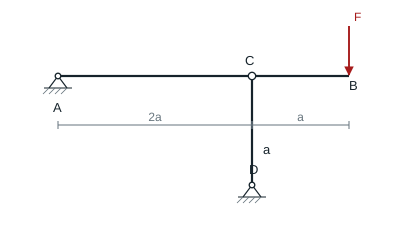
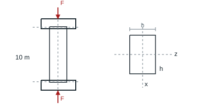
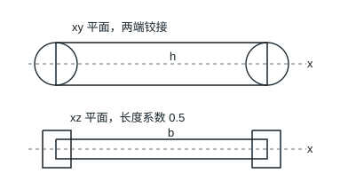
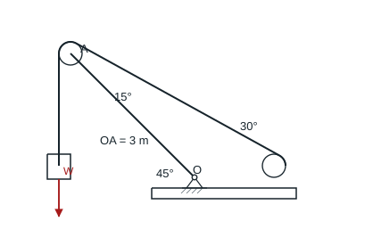

# 第 13 章 压杆稳定

教材第 217–218 页。对每个可能失稳平面分别用 $l_e=\mu l$、$i=\sqrt{I/A}$、$\lambda=l_e/i$。$\lambda\ge\pi\sqrt{E/\sigma_p}$ 时采用欧拉公式 $P_{\rm cr}=\pi^2EI/l_e^2$。

## 13.1 刚梁下方的支撑杆

### 题目

**题意**　刚梁的外端载荷使下方细长支撑杆受压。

**已知条件**　$A$ 为刚梁左铰，$AC=2a$、$CB=a$，$B$ 受向下的 $F$。支撑杆 $CD$ 长 $a=1.5$ m、两端铰接，直径 50 mm。低碳钢 $E=200$ GPa、比例极限 200 MPa。

**求解要求**　求支撑杆刚失稳时梁端荷载 $F$。

### 解答

对刚梁以 $A$ 取矩，$P_{CD}(2a)=F(3a)$。杆两端铰接，$i=d/4=12.5$ mm，$\lambda=1500/12.5=120>99.35$。用 $I=\pi50^4/64$ mm⁴。

**结果**　$P_{\rm cr}=269.15$ kN，故载荷 $F_{\rm cr}=2P_{\rm cr}/3=179.43$ kN。

## 13.2 等面积三种截面

### 题目

**题意**　比较相同用料下三种压杆截面的抗失稳能力。

**已知条件**　两端球铰，长 1.5 m，截面积 1500 mm²，$E=200$ GPa、比例极限 200 MPa。截面分别为圆、正方形、宽高比 $3/5$ 的矩形。

**求解要求**　求各自的临界压力并比较。

### 解答

两端球铰，取最小形心主惯性矩。圆、正方形和 $b/h=3/5$ 矩形分别有 $I_{\min}=A^2/(4\pi),A^2/12,(3/5)A^2/12$。代入 $A=1500$ mm²，三者柔度约为 $137.3,134.2,173.2$，均超过 99.35。

**结果**　欧拉临界力分别为 $157.08,164.49,98.70$ kN，方形最高，矩形最低。

## 13.3 销轴方向不同的矩形木压杆

### 题目

**题意**　矩形木压杆在两个弯曲平面内有不同的端部转动约束。

**已知条件**　杆长 10 m，矩形宽 $b=0.2$ m、高 $h=0.3$ m。两端相同，绕沿截面宽度方向的销轴 $z$ 可转，绕另一轴受约束。压力 120 kN，$E=10$ GPa，比例极限 20 MPa，稳定安全因素要求 3.5。

**求解要求**　分别分析两个平面，校核压杆稳定性。

### 解答

以图中截面 $z$ 轴（销轴）和 $x$ 轴为主轴。绕销轴弯曲时两端可转，$I_z=bh^3/12=4.50\times10^{-4}$ m⁴、$l_{e,z}=10$ m。另一个方向两端约束转动，$I_x=hb^3/12=2.00\times10^{-4}$ m⁴、$l_{e,x}=5$ m。柔度分别为 115.47、86.60，均大于 $\pi\sqrt{10\,000/20}=70.25$。

**结果**　临界力分别为 444.13、789.57 kN。控制方向的许用力 $444.13/3.5=126.89$ kN，大于 120 kN，满足稳定要求。

## 13.4 矩形压杆的最佳高宽比

### 题目

**题意**　调整矩形压杆的高宽比，使两个方向的稳定承载能力相匹配。

**已知条件**　杆轴为 $x$，截面在 $y$ 方向高 $h$、$z$ 方向宽 $b$。在 $xy$ 平面内两端铰接；在 $xz$ 平面内可取有效长度系数 0.5。

**求解要求**　求稳定性最佳的 $h/b$。

### 解答

在 $xy$ 平面弯曲绕 $z$ 轴，按两端铰接 $\mu_z=1$，$I_z=bh^3/12$。在 $xz$ 平面弯曲绕 $y$ 轴，$\mu_y=0.5$，$I_y=hb^3/12$。使两个方向临界力相等，避免某一方向先失稳。

**结果**　$bh^3/(1)^2=hb^3/(0.5)^2$，所以 $h/b=2$。

## 13.5 起重臂的稳定吊重

### 题目

**题意**　通过钢管起重臂的稳定条件限制吊重。

**已知条件**　起重臂 $OA$ 长 3 m，按 $O$ 固定、$A$ 自由；臂与水平成 $45^\circ$，臂端滑轮的两股绳分别竖直下垂和向右下倾 $30^\circ$。钢管外径 100 mm、内径 80 mm，$E=200$ GPa，比例极限 200 MPa，规定稳定安全因素 4。

**求解要求**　求最大允许吊重。

### 解答

轮处两段绳拉力均为 $W$，沿臂的压力分量为 $W(\cos45^\circ+\cos15^\circ)$。按题意取悬臂计算，$l_e=6$ m。$i=\sqrt{D^2+d^2}/4=32.02$ mm，$\lambda\approx187.4>99.35$。$I=\pi(D^4-d^4)/64$。

**结果**　$[W]=\pi^2 EI/[l_e^2\cdot4(\cos45^\circ+\cos15^\circ)]\approx23.75$ kN。这是题设的压杆稳定限值。

## 13.6 受热的两端固定工字钢

### 题目

**题意**　两端固结的工字钢温升后受压，按较弱弯曲方向校核。

**已知条件**　杆为 20a 工字钢，长 6 m，$30^\circ\mathrm C$ 安装时无应力，升到 $80^\circ\mathrm C$。$\alpha=5\times10^{-6}/^\circ\mathrm C$、$E=200$ GPa、比例极限 200 MPa。$A=35.6$ cm²，两主惯性矩为 158、2370 cm⁴。

**求解要求**　求升温后的工作稳定安全因素。

### 解答

热伸长完全受限，工作压应力 $E\alpha\Delta T=200\,000(5\times10^{-6})(50)=50$ MPa。弱轴 $I_y=158\times10^4$ mm⁴，$A=3560$ mm²，$l_e=3000$ mm，故 $\lambda\approx142.4>99.35$。

**结果**　$\sigma_{\rm cr}=\pi^2E/\lambda^2\approx97.34$ MPa，工作安全因素 $n=97.34/50\approx1.95$。
